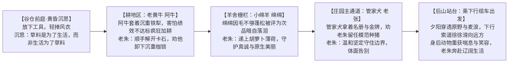

# 《特立独行的猪》现代农庄寓言全本剧本
## 舞台：新星模范生态农庄 (The Modern Farm Allegory)
## 主题：在规训中坚守本真，在从容中重拾力量

---

## 一、寓言设定与创作哲学 (Fable & Allegory)

### 1. 为什么是农庄？—— 从“露骨讽刺”到“永恒寓言”
- **避开写字楼的直白露骨**：
  直接写大厂办公室容易流于口号式吐槽或情绪对立；而**农庄**是人类讽刺文学与哲思的最高殿堂（如乔治·奥威尔《动物农场》、王小波《一只特立独行的猪》、伊索寓言）。
- **天然的动物栖息与社会隐喻**：
  - 牛拉犁耕作、马被驱使奔跑、羊被剪毛称重、猪被喂食催肥——这是农庄千百年来既定的“规训体系”，亦是现代社会各行各业打工人被定义的缩影。
  - 农庄表面是一座**“智能化、生态化、现代化的五星模范阳光农庄”**，农场广播里播放着“产肉产奶产毛协同闭环”、“争做特级标兵”。
  - 这种借由动物视角的“错位幽默”，不仅更加委婉精妙，讽刺力度反而更加深邃隽永。
- **积极温厚的社会价值**：
  老朱不带领动物去搞破坏，也不宣扬暴力对抗。他是一个**“成熟自洽、看清规则却不被驯化、游刃有余活出自我”**的智者。他用体面从容的生活方式，像一缕微风，唤醒了身边焦虑紧绷的同伴。

---

## 二、主角形象——穿风衣、戴墨镜的农庄哲人“老朱 (Mr. Pig)”

- **形象设计（《红猪》风骨 + 王小波精神）**：
  - 大家都习惯了他是只猪，但这丝毫不影响他在农庄里的威望。他曾是协助农场建立灌溉管线的资深规划师。
  - 身穿标志性的轻薄浅棕色长风衣，嘴角常年挂着一根金黄的干麦穗，鼻梁上架着复古深色小墨镜。
  - 别的猪一生都在猪圈里争抢槽里的豆粕饲料，只有老朱会跃上谷仓屋顶晒太阳、听晚风，漫步于田埂间。
  - 他步态沉稳，不疾不徐，举手投足散发着成年人独有的松弛与睿智。

---

## 三、5分钟寓言动线：黄昏 17:30 的阳光农庄大院

夕阳将整个农庄染成一片温暖醇厚的金黄色。农场下班归栏的钟声敲响，全庄动物却依然深陷“自愿加练”、“指标内耗”之中。老朱理了理风衣，准备穿过农庄大院，前往后山通往广袤天地的**【木制下山升降吊厢/下行小缆车】**回家。

---

## 四、具体剧本幕次与精妙对话设计 (极乐迪斯科质感台词)

### 【第一幕：谷仓的黄昏钟声】
- **情景**：夕阳斜斜地切过巨大的木质红谷仓，谷仓顶上的公鸡风向标缓缓转动。广播里正播送着：“今日全庄草料产能超额完成12%，请大家继续发扬奉献精神，争创明日红旗农舍！”
- **老朱的动作**：老朱从麦垛旁站起身，掸掉风衣下摆上的干草屑，端起放在木桶上的粗陶茶杯，喝下一口清冽的山泉水。
- **内心沉思**：
  > “农场主总告诉猪：吃得越多越光荣，长得越沉越有价值。  
  > 可是没有人问过猪，它究竟想不想变成案板上的重量。  
  > 今天的渠水已经引入了该去的田亩，应尽的职责已了。现在，太阳要落山了，属于我的原野在等着我。”

---

### 【第二幕：老黄牛阿牛的深渊 (耕作执念)】
- **情景**：在沉重的黑土地垄间，老黄牛阿牛正拖着一副巨大的铁犁，双眼布满血丝，蹄子在泥里打滑，喘着粗气喃喃自语：“还差半亩……必须在日落前再翻完这半亩……不然下周的精饲料配额又要被扣了……”
- **交互**：老朱走上前，顺手用脚踢开了一块死死卡在犁刃里的顽石，弯腰松开了磨损他肩膀的硬木套环。
- **对话与点拨**：
  - **阿牛**（焦虑发抖）：“朱哥……别碰我的套！我还能拉！隔壁马圈的烈马今天跑了五趟长途，我这头老黄牛要是地翻得不够多，很快就会被拉去……”
  - **老朱**（从容一笑，按住阿牛沉重的肩胛）：
    > “阿牛，低头看看你的脚下。犁刃卡在石头里快两个时辰了，你是在跟大地较劲，还是在跟自己的恐惧死磕？  
    > 这副犁是农庄发给你的，但筋骨和生命是你自己的。大地每年都要冬眠，连这片黑土地都懂得休养生息，你一头活生生的牛，要把自己熬成铁铸的标本吗？  
    > 卸下来吧。回去洗洗蹄子，草料吃多吃少饿不死牛，今晚星空很亮，去小溪边喝口清水。”
  - **阿牛的转变**：阿牛怔怔地看着被老朱取下的顽石，沉重的牛头缓缓垂下，长长地呼出一道白汽，眼神中的浑浊散去，露出了多年未见的释然与清澈。

---

### 【第三幕：羊圈角落的暗自抽泣 (小绵羊绵绵)】
- **情景**：在矮木栅栏旁，刚被剃完毛的小绵羊绵绵正蜷缩在草垛阴影里，低头小声抽泣。栅栏上挂着一张木牌，上面用红墨水盖着大大的字样——“三等次品毛：过于纤细，缺乏工业强度”。
- **交互**：老朱走过去，顺手扶正了被碰倒的小木槽，从风衣口袋里掏出一颗水灵灵的小野胡萝卜和几片嫩薄荷叶放在草垛上。
- **对话与守护**：
  - **绵绵**（抽泣，抱住光秃秃的自己）：“朱先生……他们说我的毛又细又软，织不出笔挺厚重的工作服，说我是农场里最没用的羊……我是不是天生就是个累赘？”
  - **老朱**（靠在木栅栏上，推了推墨镜，仰望天边金红色的晚霞）：
    > “小绵羊，你知道为什么他们嫌你的毛太软吗？  
    > 因为他们只想要流水线上千篇一律的粗毛毡，却不懂得云朵原本就是柔软的。  
    > 你的毛柔软，是因为你天性细腻温厚，对每一阵春风都有感知。那不是缺陷，那是造物主给你的特立独行的印记。  
    > 别用屠户和纺织工的眼光来审视自己的灵魂。把这根胡萝卜吃了，天冷了，早点进窝，你的春天比这间棚子辽阔得多。”
  - **绵绵的转变**：绵绵擦干眼泪，咬了一口脆甜的胡萝卜，眼睛弯成了月牙，第一次挺起了小小的胸脯。

---

### 【第四幕：大院主干道上的挽留 (管家犬老张)】
- **情景**：穿过农场中庭，管家牧羊犬老张戴着铜铃铛，夹着一本厚重的牲畜档案簿迎面走来。看到老朱披着风衣走向后山，老张急忙摇晃着铃铛拦在路中。
- **对话与成年人的分寸智慧**：
  - **老张**（居高临下施压，又带着诱惑）：“老朱啊！这太阳才刚挨着山头，你怎么就往外走？庄园主今年特批了，只要你答应留在中心展示区做‘终身模范生态猪’，每天不仅供应高蛋白豆饼，下个月司庆还给你颁发金铃铛勋章！这可是全庄几百头动物熬一辈子都盼不来的荣誉啊！”
  - **老朱**（停下脚步，神情淡定自若，微笑着直视老张的双眼）：
    > “张管家，这农场东边三条引水渠的坡度我今天已经校准完毕，图纸放在工具房的红木桌上，保证开春灌溉无虞，我没有欠庄园一分力气。  
    > 至于金铃铛和模范槽位……那些镀金的项圈，还是留给愿意在槽前排队的人吧。  
    > 圈养得再体面，也是在笼子里数日子；野地里的酸浆果虽然涩口，但每一口嚼碎的都是自由的风。  
    > 铜铃很响，但山风更大。张管家，看守大院辛苦了，早点歇着吧。”
  - **老张的反应**：老张愣在原地，爪子里的铃铛停了下来。在老朱那份平静如水却又不可动摇的坦荡面前，所有威吓与画饼的话术彻底失去了分量。老张最终低声叹道：“……你啊，终究还是当年那只谁也圈不住的猪。走吧老朱，山路慢行。”

---

### 【第五幕：后山索道与下行缆车 (终章演出)】
- **情景**：
  - 老朱来到农庄最高处的后山崖口，这里坐落着一座古老的木结构索道站台。
  - 夕阳在漫无边际的金黄麦浪与远山森林上铺上了一层浓重温暖的光辉。
  - 背景响起带有泥土清香与自由气息的木吉他与风笛合奏。
- **动作与交互**：
  - 老朱握住木质升降缆车的启动铜杆，向下轻轻一推。
  - 齿轮卡嗒作响，吊厢门徐徐滑开，缆绳在落日余晖中发出低沉平稳的共鸣。
- **回望**：
  - 老朱站在吊厢前，回头望去——
  - 晚风吹拂麦浪，阿牛已经卸下了沉重的铁犁，坐在溪边悠然甩着尾巴；小绵羊绵绵在草垛旁好奇地向远方挥手；农庄深处的冷清与焦虑，正被这片宏大的黄昏自然悄悄融化。
- **踏入缆车**：
  - 老朱踏进吊厢，双手搭在木质护栏上，微笑着推了推鼻梁上的小墨镜。
  - 缆车沿着索道缓缓下行，滑向群山环抱的原野与自由的炊烟之处。
- **终屏金句**：
  > **“世间只有一种真正的特立独行，那就是认清生活的规训后，依然选择从容而体面地活出自己。”**  
  > **“不随波逐流，亦不愤世嫉俗；守住内心的火，走属于自己的路。”**  
  > **“愿每一颗不肯被驯服的灵魂，都能在阳光下的广阔田野里自由漫步。”**
