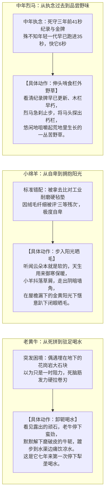

# 《一口猪在金牌农场》史诗故事全本 (黑客帝国抉择与行动觉醒版 · 终极定本)

> **空间法则**：悬崖在下方，自下而上进发的突围之旅  
> **核心主题**：黑客帝国的红蓝抉择 · 行动先于顿悟 · 荒谬工业流水线下的生灵生态  
> **二元结局**：【结局一：安稳的肉馅】 vs 【结局二：旷野的呼唤】

---

## 一、核心世界观与深层叙事法则

### 1. 黑客帝国式的红蓝抉择 (The Red & Blue Pill Dilemma)
在故事序幕，绝壁上的老岩羊不会给猪灌输伟大的英雄梦想，而是像《黑客帝国》里的墨菲斯一样，把冷酷的世界真相撕开，直接推给它一个**无法回避的二元抉择**：

| 抉择方向 | 隐喻 | 玩家选择 | 对应结局与成就 |
| :--- | :--- | :--- | :--- |
| **蓝色选择 (Blue Pill)** | 沉溺温柔乡，接受既定命运 | 掉头钻回温热泥坑，把头埋进食槽抢食发酵糖蜜料 | **【结局一：安稳的肉馅】**<br/>🏆 成就解锁：`【温热的泥浆】` (A Warm Wallower) |
| **红色选择 (Red Pill)** | 斩断退路，直面绝壁与凶险 | 叼起老岩羊踢来的生锈古索道铜插销，顶烂木门栓向大院进发 | **【结局二：旷野的呼唤】** (通向突围正线)<br/>🏆 成就解锁：`【红色的生锈插销】` (The Rusty Red Pin) |

---

### 2. 生态位与紧迫度对比：猪的生死绝境 vs 牛羊马的“缓缓”
这是整部作品最深刻的现实主义底色：**不同的动物在农场机器中拥有完全不同的经济价值与生死周期。**

- **猪（肉用牲畜·命悬一线·无路可退）**：
  - 猪在农场里的唯一任务就是**长肉和被屠宰**。它不产毛，不耕田，不拉车。增重指标一达标，生命的倒计时就清零了。
  - 山脚下第三肉联厂的运牲大卡车明早六点准时开进大门，它**只有今夜一次机会，必须二选一，非生即死**。
- **牛、羊、马（生产/役用牲畜·拥有长期价值·可以缓缓）**：
  - **老黄牛**：耕作重役。哪怕老了瘦了，只要还能拉犁翻垄，农场就不会轻易杀它，还要靠它省下柴油钱；
  - **小绵羊**：产毛经济动物。每年开春剪毛，只要活着就能持续产毛，就算被评为次品，也不会今晚被拖去屠宰；
  - **烈马追风**：展示与竞速资产。基地门面的中年良驹，享受着单独马厩。
  - **核心转变逻辑**：因此，**牛羊马不需要像猪那样急迫地做出反叛，更不需要宏大深刻的心态独白！** 它们面对误区，只需要做出一个小小的、跳出当前执念的选择。**它们可以缓缓，甚至只是做一个具体的动作——停下、喝水、晒太阳、嚼野草——心境便已截然不同。**

---

### 3. 素昧平生的相遇与行动表达心境 (Strangers & Action Speaks)
所有动物在此之前彼此**素昧平生，互不相识**。相逢时有着天然的陌生感与本能防备，必须经过自然的相互介绍。摒弃繁复说教与瞬时顿悟，以极其克制、具象的身体动作呈现生灵从误区中的脱身：



---

## 二、英雄之旅十二阶段完整长篇剧本

### 【第一幕：启程与抉择 (Departure & The Choice)】

#### 阶段 1：平凡世界 (The Ordinary World)
- **场景**：屏幕正下方，悬崖边潮湿阴暗的残破旧猪舍。
- **常态**：晨雾笼罩深渊。同栏的大白猪为了半勺发酵糖蜜泔水撕咬尖叫。白净匀称的猪“包子”把下巴搭在石墙上，看苍穹飞鸟掠过绝壁。它的耳上打着【047】黄色耳标，后臀盖着未干的红色检疫圆印。

#### 阶段 2：冒险召唤与黑客帝国抉择 (Call & The Matrix Choice)
- **动作**：老岩羊从万丈悬崖下一跃而起，稳稳立在残石墙上。
- **对话与抉择**：
  - **老岩羊**：“喂，小胖子。天天看天，天里有肉馅大包子掉下来？”
  - **猪**：“天里没吃的。但天上面没有栏杆，也没有水泥槽。”
  - **老岩羊**（踢出一枚生锈古索道铜插销，插在泥地与食槽之间）：“饲养员叫你‘包子’，皮薄肉多。山脚下第三肉联厂的运牲卡车已经在烧柴油冒黑烟了。明早六点头道铁栅一开，第一个挂吊钩的就是你。
    
    **现在，你蹄子前面有两条路：**
    
    **第一条路（蓝色）**：转过身，回泥窝里去，把头扎进食槽，大口吃你那槽甜料。挨过今晚，明早在温饱里挨上一刀，当一屉合格的肉馅大包子。
    
    **第二条路（红色）**：叼起这枚生锈的铜插销，撞烂身后的木门栓，顺着大院一路往上闯。悬崖很高，猎犬很凶，你可能会摔死在乱石堆里，也可能会死在狗牙下。
    
    选吧。回你的槽边去，还是跟我上山？”

---

#### 【分支结局一：安稳的肉馅 (Ending 1)】
*如果玩家在对话选项中选择：`【掉头钻回泥窝】“悬崖太冷了，我只想安安稳稳吃口饱饭……”`*

- **结局演播**：
  - 猪没有碰那枚冰冷的铜插销。它慢慢转过身，在同伴的哼哧声中挤回水泥食槽边。
  - 它把长鼻深深扎进温热甜腻的发酵饲料里，大口吞咽，随后蜷缩在温暖发臭的泥浆中，舒服地哼了哼声。
  - 老岩羊在残墙上看着它，沉默片刻，转身跃回深渊。
  - 屏幕渐渐淡出为暗黑。背景音中，远处山谷传来了卡车低沉的柴油引擎声与刹车尖鸣。
  - **终屏金句**：
    > “温热的泥浆漫过肚皮，发酵甜料甜得发腻。  
    > 山脚下的柴油车很远，此刻的温饱很近。  
    > 做一头合格的肉猪，安享一宿安稳，这又何尝不是一种选择。”
  - 🏆 **成就解锁**：**【温热的泥浆 (A Warm Wallower)】**
  - *(画面提供按钮：【重新抉择】)*

---

#### 【主线继续：红色抉择与跨越边界 (The Red Choice & Threshold)】
*如果玩家在对话选项中选择：`【咬紧牙关叼起铜插销】“掉下悬崖摔死，也比被挂在挂钩上放血强！”`*

- **动作**：猪叼起带着泥腥味的生锈铜插销。
- 🏆 **成就解锁**：**【红色的生锈插销 (The Rusty Red Pin)】**
- 它四蹄发软，战栗着后退两步，低下坚硬的猪拱嘴，拼尽全力猛撞木门栓——**咔嚓！厚重门栓折断！**
- 猪正式迈出猪圈，怀着未知的恐惧踏上向上的石板路！

---

### 【第二幕：启蒙与试炼 (Initiation)】

#### 阶段 6：考验与盟友 (陌路相逢，以行动展现心境)

##### 试炼一：黑土垄的老黄牛 ➔ 【坚忍之骨】
- **相遇与介绍**：
  - 老黄牛正深陷黑泥死命拉犁，四蹄刨出深坑，前膝跪地，嘴角白沫狂涌。
  - **老牛**（通红着眼大喘粗气）：“滚开！别挡道！……你是一头白猪？从哪冒出来的？！快让开，别挡我的犁沟！今天还有两亩地，只要我再咬紧牙拼一把力气，这道坎就能犁过去！”
  - **猪**（站在泥垄边）：“我……我是从山脚下破圈里跑上来的。大叔，你犁头不对劲！”
- **破局与对话**：
  - 猪凑上前，用硬鼻梁顶开深层烂泥——**原来犁尖并不是卡在地质石脉上，而是死死别在了一块被泥浆掩埋的花岗岩大石块底部！犁铁已经被硬生生崩出了深口卷刃！**
  - **猪**：“大叔，你别死拼了！下面埋着一块磨盘大的花岗岩大石块！你以为是一时的硬泥，其实犁头早就卷了。再拼下去，石头碎不了，断的是你自己的颈椎大筋。农场还指望你耕地，不会今晚杀你，你犯不着在这儿钻牛角尖。”
- **具体行动（心境展现）**：
  - 老牛看着那块露出的灰白大石块与卷曲的犁尖，浑身猛烈震颤了一下。它那股盲目死磕的蛮劲忽然泄了。
  - 它没有长篇大论，只是慢慢用牛角顶开了磨破皮肉的沉重木轭。
  - **老牛踩着黏稠的泥水，一步步踱步到旁边的石水渠边，低下头，长长地痛饮了一大口清凉甘甜的井水。**
  - 它抬起头，水珠顺着胡须滴落，看着远山轻轻喷出一股白汽。它七年来第一次在劳作中停下来喝水。
- **汲取意志**：猪看着老牛沉稳如山的身躯，学会了**【坚忍之骨】**——不盲目蛮干，但扛得住泰山压顶的厚重沉稳。

##### 试炼二：废木棚的小绵羊 ➔ 【洞察之眸】
- **相遇与介绍**：
  - 穿过果园，猪来到简陋阴暗的剪毛矮棚。
  - 一只被推剪得参差不齐的小绵羊缩在干草堆后瑟瑟发抖，木栏上贴着刺目的粉笔字：【三等残次：纤维过细过软，缺乏刚性，无法压制工业耐磨硬毡垫】。
  - **小羊**（挂着眼泪，戒备地往草堆深处缩）：“你……你是谁？我从没在羊棚见过你……你是一头猪？你怎么跑到这里来了……”
  - **猪**：“我从下头的下栏猪圈跑出来的，饲养员叫我‘包子’。你呢，为什么一个人躲在暗处哭？”
  - **小羊**（吸着鼻子）：“我是二号棚的细毛绵羊……他们说我的毛太软了，压不成垫在机床底下的硬毡垫，连当工业边角料都不配……我是不是全农场最差的一只羊……”
- **破局与对话**：
  - **猪**一脚踢碎写着残次的破木牌：
    > “机修车间的工业毡垫是垫在重型机床底下吸机油、防震动的，当然要粗硬得像铁丝才压不烂。  
    > 你的毛长得像天上的云彩一样轻柔，天生是用来做贴身保暖的软毛衣衫的。  
    > 他们厂里只有粗活，拿压机床垫子的粗尺来量你，那是他们只有粗活。农场还要靠你年年剪毛卖钱，你又没有生命危险，何必躲在这儿自卑？”
- **具体行动（心境展现）**：
  - 小羊怔怔看着自己身上的白色绒毛。它没有激昂表态。
  - **它站起身抖了抖身子，把身上的草屑与灰尘抖落，一身蓬松雪白的卷毛瞬间如云朵般舒展开来。**
  - **小羊迈着轻细的小蹄子走出潮湿阴暗的角落，在破屋顶漏下的一缕金黄温暖的阳光中舒服地趴下，把下巴搭在干木板上，惬意地眯起了眼睛。**
  - 它不再躲在暗处为“不够粗硬”而瑟瑟发抖。
- **汲取意志**：猪看着在阳光下安然舒展的小羊，领悟了**【洞察之眸】**——看穿狭隘虚妄标尺、直抵生命本质的至纯清澈。

##### 试炼三：跑道泥圈的烈马 ➔ 【疾风之步】
- **相遇与介绍**：
  - 大院第三层：环形泥地跑道。
  - 一匹黑色骏马双眼圆睁，在50米椭圆泥圈里疯狂狂奔，蹄铁溅出阵阵泥浆。
  - **烈马**（疾驰掠过，大声暴喘）：“闪开！别挡道！……你打哪来的？！一只肉猪怎么敢闯进赛道？！”
  - **猪**（站在木栏外喊道）：“我从下面的圈里跑出来的！大叔，你跑这么急是要去哪？！”
  - **烈马**（骄傲狂躁）：“我是这里的‘追风’！我在跑配速！这一圈我跑了41秒！只要我今天跑满三万步，维持住41秒的成绩，终点看台上的速度冠军金牌就还是我的！”
- **破局与对话（中年马的执念）**：
  - 猪顺着它狂奔的方向看去，看台正上方确实挂着一块锈蚀的金牌纪录榜。
  - **猪**（指着木板大声喊道）：
    > “大叔！你停下来看看那面纪录牌！  
    > 牌子上的纪录去年春天就换了！现在的头名是三号棚新来的纯血小马，35秒！人家比你当年的纪录快了整整6秒！  
    > 农场早就一年没给你排过正式比赛了！木栏杆早朽烂了，外面就是八百里草甸！  
    > 农场把你当退役良驹养着养老，又没人拿刀逼你，你何必死咬着过去的41秒，睁着眼睛骗自己？！”
- **具体行动（心境展现）**：
  - 烈马四蹄在泥浆中拉出四道深深的沟壑，伴随着一声粗重的喘息，猛然在泥地中刹住步子！
  - 它胸膛剧烈起伏，转头死死盯着看台上那行写着“35秒”的崭新白漆，又看了看自己蹄下重叠踩了千万次的泥槽。
  - 它没有仰天长啸，也没有疯狂冲撞。
  - **烈马缓步走到了朽烂脆弱的半人高木栏边，把长长的马头伸出了围栏外，低头悠闲地啃食起荒坡上生长的一丛苦野草。**
  - 它一边嚼着带有泥土清香的野苜蓿，一边慢悠悠地甩着尾巴。那股困在41秒金牌执念里的狂躁，在这口苦野草中彻底消散。
- **汲取意志**：猪体会到了烈马体内破除虚荣执念后真正的奔腾自由，获得了**【疾风之步】**——不再为虚名跑圈，而为辽阔天地掌控节奏的极速。

---

#### 阶段 7：接近最后关卡 (Approach to the Inmost Gate)
- 猪穿过赛道，来到了通往后山绝顶的最后一道高耸防逃铁闸门前。
- 山脚下运猪车的柴油机轰鸣越来越近，全庄警报尖锐炸响！
- 杜宾护院犬群狂吠着追击而来。猪深知：**牛、羊、马都有退路，可以缓缓享受生活，但自己只有今夜！**

---

#### 阶段 8：严峻生死考验 (The Ordeal) —— 犬与猪的大追逐战 (The Great Chase)
- **第一阶段【马之速·疾风之步】**：猎犬自后方飞扑追咬，猪利用高频变向在农具箱堆与草垛间疾驰穿梭，甩脱獠牙扑杀；
- **第二阶段【羊之智·洞察之眸】**：犬群借烟尘施展“分身疑兵围捕”，猪凭借纯澈的洞察之眸一眼看穿扑咬虚招，避开捕兽网陷阱；
- **第三阶段【牛之劲·坚忍之骨 (QTE)】**：通向铁闸门的坡道前，巡逻恶犬凌空飞跃将猪死死咬住压倒！屏幕QTE蓄力爆发，猪凝聚老牛坚忍巨力，悍然铁头暴挑，掀翻恶犬冲上闸门前！

---

#### 阶段 9：夺取真理之剑 (The Reward) —— 人类与猪的宝可梦式终极对决
在通往后山索道的最后铁闸门前，没有繁复多余的钟楼，只有手持高压电击棍与饲料桶的**农场人类主管（周主管）**亲自堵在锁链闸门前！

```
============================================================
【终极意志对决开始！】
野生的一口猪（Lv.99 特立独行形态） VS 农场人类主管·周主管 (手持高压电击棍)
============================================================

【第一回合：高产指标与甜料诱惑】
周主管 使用了技能：【加料糖蜜桶 & 评优耳标】！
周主管：“047号！皮薄肉多的包子！你竟然敢从圈里跑出来？！
明早六点肉联厂的车就要来装货了，老老实实滚回秤上去，今晚给你加满甜麦麸！”
猪 受到温饱诱惑冲击……但触发了被动【牛之坚忍】！
猪 发动了反击：【真理诘问】！
猪：“甜料再甜，也是买命的饵！你们养我不是为了善待，是为了按斤称肉！”
周主管的【体制威严】产生裂痕！信念值下降！

【第二回合：电击棍威吓与规训压制】
周主管 使用了技能：【高压电击棍 & 肉猪天职】！
周主管：“混账！肉猪的天职就是长肉！没有农场，你走出大门就是死路一条！”
猪 触发了被动【羊之洞察】！
猪 发动了反击：【破除规训】！
猪：“谁说长着四蹄的生灵生来就必须是肉馅？！你们订的标准，绑不住想看天的心！”
周主管陷入混乱状态！防御彻底崩溃！

【第三回合：破门一击与真理冲撞】
周主管 孤注一掷！挥舞高压电击棍扑面击来！
猪 凝聚了【马之疾风爆发】！
猪 释放了终极技能：【真理冲撞·铁嘴破门】！
猪借力腾空一跃，用坚硬如生铁的猪拱嘴，狠狠撞飞电击棍，重重撞碎铁闸门上的大铁锁！
【效果拔群！厚重铁锁粉碎！大门轰然洞开！】
============================================================
```

- **高潮视听爆发**：
  - 铁锁粉碎，高耸的铁闸门向两侧大敞！
  - 周主管跌坐在地，电击棍在地上嗞嗞冒着火星，满脸惊骇地看着这头破门而出的生灵。
  - 大门之外，通向后山悬崖索道的石径在月光与山风中豁然开朗！

---

### 【第三幕：归途与重生 (Return)】

#### 阶段 10：返回之路 (The Road Back)
- 猪冲过敞开的铁门，跑上通向后山索道的绝顶石崖。
- 夜风吹散了农场的血腥与机油味，群星璀璨。
- 远处的黑土垄边，老黄牛站在水渠旁静静喝着水；羊舍旁，小绵羊在月色下的暖板上睡得安详；跑道边，烈马正嚼着栏外的野草。它们在山风中目送着这道粉白色的身影。

#### 阶段 11：灵魂蜕变与复活 (The Resurrection)
- **场景**：屏幕最顶端，后山绝顶悬崖索道崖口。
- 追到崖口的只有看守大门的老张（管家犬）。大门已破，主人倒地，老张瘫坐在碎石地上，看着自己脖子上那只刺目的纯铜铃铛，抱头大哭：
  - **老张**：“门砸烂了……规矩没了……明天大门打开，没有农场，我们怎么活啊……”
- 猪在索道吊厢前停下蹄子。猪没有挖过水渠，它只是一头逃跑的肉猪。它看着老张，平静而自然地开口：
  > “我只是一头猪。我没有给这农场留下过任何东西，但我也不欠这农场任何东西。  
  > 铜铃你摇得很响，但山风更大。你是一只狗，不是挂在大门上的铁锁。  
  > 门已经开了，你也该卸下铃铛，去草地上打个滚了。”
- 老张怔怔看着眼前这头眼神如星空般清澈的猪，老泪流下。它用爪子解下了勒紧脖颈十年的纯铜铃铛，当啷一声，扔进了深渊山泉中。

#### 阶段 12：携灵药归来与结局二 (Return with the Elixir - Ending 2)
- 猪跃上木质索道吊厢，将老岩羊给它的生锈铜插销狠狠撞入绞盘卡槽！
- **咔嗒！滑轮咬合！**
- 木吊厢在黎明的晨曦与漫天朝霞中，滑离绝壁，向着悬崖下方无穷无尽的金黄麦浪与自由群山飞驰而下！
- 🏆 **成就解锁**：**【特立独行的先驱 (The Maverick Pioneer)】**
- **终屏金句**：
  > **“金牌是农场的，但命是你自己的。”**  
  > **“这世上只有一种特立独行：看清了槽里的把戏，依然坦坦荡荡奔向旷野。”**  
  > **“一口猪走出了围城；天地很大，下山见。”**
