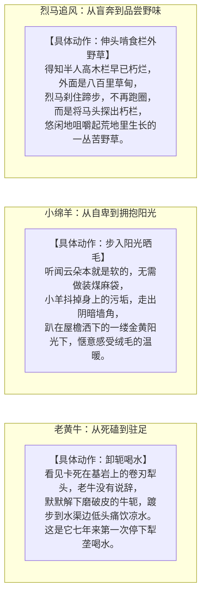

# 《一口猪在金牌农场》史诗故事全本 (黑客帝国抉择与行动觉醒版)

> **空间法则**：悬崖在下方，自下而上进发的突围之旅  
> **核心主题**：黑客帝国的红蓝抉择 · 行动先于顿悟 · 荒谬工业流水线下的生灵生态  
> **二元结局**：【结局一：安稳的肉馅】 vs 【结局二：旷野的呼唤】

---

## 一、核心世界观与深层叙事法则

### 1. 黑客帝国式的红蓝抉择 (The Red & Blue Pill Dilemma)
在故事序幕，绝壁上的老岩羊不会给猪灌输伟大的英雄梦想，而是像《黑客帝国》里的墨菲斯一样，把冷酷的世界真相撕开，直接推给它一个**无法回避的二元抉择**：

| 抉择方向 | 隐喻 | 玩家选择 | 对应结局与成就 |
| :--- | :--- | :--- | :--- |
| **蓝色选择 (Blue Pill)** | 沉溺温柔乡，接受既定命运 | 掉头钻回温热泥坑，把头埋进食槽抢食发酵糖蜜料 | **【结局一：安稳的肉馅】** 🏆 成就解锁：`【温热的泥浆】` (A Warm Wallower) |
| **红色选择 (Red Pill)** | 斩断退路，直面绝壁与凶险 | 叼起老岩羊踢来的生锈古索道铜插销，顶烂木门栓向大院进发 | **【结局二：旷野的呼唤】** (通向突围正线) 🏆 成就解锁：`【红色的生锈插销】` (The Rusty Red Pin) |

---

### 2. 生态位与紧迫度对比：猪的生死绝境 vs 牛羊马的“缓缓”
这是整部作品最深刻的现实主义底色：**不同的动物在农场机器中拥有完全不同的经济价值与生死周期。**

- **猪（肉用牲畜·命悬一线·无路可退）**：
  - 猪在农场里的唯一功能就是肉身。增重指标一达标，生命的倒计时就清零了。
  - 山脚下第三肉联厂的运牲大卡车明早六点准时开进大门，它**只有今夜一次机会，必须二选一，非生即死**。
- **牛、羊、马（生产/役用牲畜·拥有长期价值·可以缓缓）**：
  - **老黄牛**：耕作重役。哪怕老了瘦了，只要还能拉犁翻垄，农场就不会轻易杀它，还要靠它省下柴油钱；
  - **小绵羊**：产毛经济动物。每年开春剪毛，只要活着就能持续产毛，就算被评为次品，也不会今晚被拖去屠宰；
  - **烈马**：展示与速度资产。作为示范基地的门面良驹，享受着专属马厩。
  - **核心转变逻辑**：因此，**牛羊马不需要像猪那样急迫地做出反叛，更不需要宏大深刻的心态独白！** 它们面对误区，只需要做出一个小小的、跳出当前执念的选择。**它们可以缓缓，甚至只是做一个具体的动作——停下、喝水、晒太阳、嚼野草——心境便已截然不同。**

---

### 3. 行动表达心境 (Action Speaks Louder Than Words)
摒弃繁复说教与瞬时顿悟，以极其克制、具象的身体动作呈现生灵从误区中的脱身：

---

## 二、英雄之旅十二阶段完整长篇剧本

### 【第一幕：启程与抉择 (Departure & The Choice)】

#### 阶段 1：平凡世界 (The Ordinary World)
- **场景**：屏幕正下方，悬崖边潮湿阴暗的残破旧猪舍。
- **常态**：晨雾笼罩深渊。同栏的肥猪为了半勺发酵糖蜜泔水撕咬尖叫。白净匀称的猪“包子”把下巴搭在石墙上，看苍穹飞鸟掠过绝壁。它的耳上打着【047】黄色耳标，后臀盖着未干的红色检疫圆印。

#### 阶段 2：冒险召唤与黑客帝国抉择 (Call & The Matrix Choice)
- **动作**：老岩羊从万丈悬崖下一跃而起，稳稳立在残石墙上。
- **对话与抉择**：
  - **老岩羊**：“小胖子，天天看天，天里有大包子掉下来？”
  - **猪**：“天里没吃的。但天上面没有栏杆，也没有水泥槽。”
  - **老岩羊**（踢出一枚生锈古索道铜插销，插在泥地与食槽之间）：“饲养员叫你‘包子’，皮薄肉多。山脚下第三肉联厂的运牲卡车已经在烧柴油冒黑烟了。明早六点头道铁栅一开，第一个挂吊钩的就是你。
    
    **现在，你蹄子前面有两条路：**
    
    **第一条路（蓝色）**：转过身，回泥窝里去，把头扎进食槽，大口吃你那槽甜料。挨过今晚，明早在温饱里挨上一刀，当一屉合格的肉馅大包子。
    
    **第二条路（红色）**：叼起这枚生锈的铜插销，撞烂身后的木门栓，顺着大院一路往上闯。悬崖很高，猎犬很凶，你可能会摔死在乱石堆里，也可能会死在狗牙下。
    
    选吧。回你的槽边去，还是跟我上山？”

---

#### 【分支结局一：安稳的肉馅 (Ending 1)】
*如果玩家在对话选项中选择：`【掉头钻回泥窝】“悬崖太冷了，我只想安安稳稳吃口饱饭……”`*

- **结局演播**：
  - 猪没有碰那枚冰冷的铜插销。它慢慢转过身，在同伴的哼哧声中挤回水泥食槽边。
  - 它把长鼻深深扎进温热甜腻的发酵饲料里，大口吞咽，随后蜷缩在温暖发臭的泥浆中，舒服地哼了哼声。
  - 老岩羊在残墙上看着它，沉默片刻，转身跃回深渊。
  - 屏幕渐渐淡出为暗黑。背景音中，远处山谷传来了卡车低沉的柴油引擎声与刹车尖鸣。
  - **终屏金句**：
    > “温热的泥浆漫过肚皮，发酵甜料甜得发腻。  
    > 山脚下的柴油车很远，此刻的温饱很近。  
    > 做一头合格的肉猪，安享一宿安稳，这又何尝不是一种选择。”
  - 🏆 **成就解锁**：**【温热的泥浆 (A Warm Wallower)】**
  - *(画面提供按钮：【重新抉择】)*

---

#### 【主线继续：红色抉择与跨越边界 (The Red Choice & Threshold)】
*如果玩家在对话选项中选择：`【咬紧牙关叼起铜插销】“掉下悬崖摔死，也比被挂在挂钩上放血强！”`*

- **动作**：猪叼起带着泥腥味的生锈铜插销。
- 🏆 **成就解锁**：**【红色的生锈插销 (The Rusty Red Pin)】**
- 它四蹄发软，战栗着后退两步，低下坚硬的猪拱嘴，拼尽全力猛撞木门栓——**咔嚓！木栓折断！**
- 猪正式迈出猪圈，怀着未知的恐惧踏上向上的石板路！

---

### 【第二幕：启蒙与试炼 (Initiation)】

#### 阶段 6：考验与盟友 (行动表达心境，不急于求成)

##### 试炼一：黑土垄的老黄牛 ➔ 【坚忍之骨】
- **情境**：老黄牛陷在黑泥里死拉深犁，四蹄刨出血口，双眼通红，拼命发力。
- **对话**：
  - **老牛**（喘息呼哧）：“别挡道！今天还有两亩地……只要我多流一把汗，就没有翻不过去的泥！”
  - 猪用硬鼻梁顶开深泥，露出一整块深埋地下的千年花岗岩，犁尖早已卷刃。
  - **猪**：“牛大叔，下面是块花岗岩床。犁头早卷了，你再拉，断的是自己的大筋。农场还指望你耕地，不会今晚杀你，你犯不着在这儿钻牛角尖。”
- **具体行动（心境展现）**：
  - 老牛看着露出的白石头，神情一愣。它没有高谈阔论，只是默默用牛角顶开了磨破皮肉的牛轭。
  - **老牛踩着泥浆，一步步踱步到旁边的石水渠边，低下头，长长地痛饮了一大口清凉甘甜的泉水。**
  - 它抬起头，嘴边滴着清水，看着远山，轻轻喷了一口白汽。它七年来第一次在劳作中停下来喝水。
- **汲取意志**：猪看着老牛沉稳如山的身躯，学会了**【坚忍之骨】**——不盲目死拼，但扛得住任何风暴。

##### 试炼二：废木棚的小绵羊 ➔ 【洞察之眸】
- **情境**：小绵羊缩在阴暗潮湿的木棚角落，栏杆贴着“三等残次：毛质细软，无法做耐磨帆布”，满眼含泪。
- **对话**：
  - **小羊**：“阿猪哥……我的毛太软了，连做麻袋的资格都没有，我是不是天生就是个废物？”
  - **猪**一脚踢烂残次木牌：
    > “帆布是用来装煤炭、垫粗木的。羊毛生来是用来保暖的，你长得像云彩一样软，是天生给人御寒的宝贝。  
    > 他们用装煤的眼光量你，那是他们瞎。农场还要剪你的毛，你又没有生命危险，何必躲在这儿自卑？”
- **具体行动（心境展现）**：
  - 小羊怔怔看着自己身上的绒毛。它没有激昂表态。
  - **它抖了抖身子，把身上的干草屑抖落，一身蓬松雪白的卷毛瞬间如云朵般舒展开来。**
  - **小羊迈着轻细的小蹄子，从阴暗潮湿的角落走出来，趴在破屋顶漏下的一缕金黄温暖的阳光中，舒服地把下巴搭在暖洋洋的干木板上，轻轻闭上了眼睛。**
  - 它不再因“不符合帆布标准”而躲在暗处发抖。
- **汲取意志**：猪看着在阳光下安然舒展的小羊，领悟了**【洞察之眸】**——看破虚妄标准的纯粹智慧。

##### 试炼三：跑道泥圈的烈马 ➔ 【疾风之步】
- **情境**：黑色骏马追风双眼圆睁，在50米椭圆泥圈里疯狂狂奔，汗流浃背，死死盯着前方插着的红旗。
- **对话**：
  - **追风**（暴喘）：“别挡我的道！这一圈配速41秒！只要我跑满三万步，我就是全场速度冠军！”
  - **猪**站在木栏边高喊：“追风！你眼睛睁得这么大，每一圈踩的都是前一圈的泥印！木栏杆早朽烂了，外面就是八百里草甸！农场还要靠你当门面，又没人拿刀架着你，你何必睁着眼睛骗自己？”
- **具体行动（心境展现）**：
  - 烈马四蹄在泥浆中死死拖出四道长痕，猛然刹住步子！
  - 它剧烈喘息着，转过头看着那截半人高的朽烂木栏。它没有仰天长啸，也没有立刻跳出围栏。
  - **烈马缓步走到了朽烂的木栏边，把长长的马头伸出围栏外，悠闲地低头啃食起荒坡上生长的一丛苦野草。**
  - 它一边嚼着带有泥土清香的野苜蓿，一边慢悠悠地甩着尾巴。跑圈的循环魔咒，在这一口青草中化为乌有。
- **汲取意志**：猪感受到了烈马体内那股从容掌控速度的力量，获得了**【疾风之步】**——随心而动、破阵突围的极速。

---

#### 阶段 7：接近最深洞穴 (Approach to the Inmost Cave)
- 猪来到大院最上方的红砖钟楼前。山脚下运猪车的柴油机轰鸣越来越近，全庄警报尖锐炸响！
- 管家犬老张率领巡逻猎犬队自台阶合围扑杀而来。猪深知：**牛羊马有退路，可以缓缓，但自己只有今夜！**

---

#### 阶段 8：严峻生死考验 (The Ordeal) —— 犬与猪的大追逐战 (The Great Chase)
- **第一阶段【马之速·疾风之步】**：猎犬飞扑追咬，猪利用高频变向在木箱杂物间穿梭，避开獠牙；
- **第二阶段【羊之智·洞察之眸】**：犬群借扬尘施展“分身疑兵阵”，猪看穿虚招，精准绕开扑杀与钢丝陷阱；
- **第三阶段【牛之劲·坚忍之骨 (QTE)】**：终点前恶犬飞扑将猪咬倒压制！QTE蓄力爆发，猪借老牛坚忍之力猛然昂头，将恶犬撞飞下石阶，撞破大门杀入钟楼配电房！

---

#### 阶段 9：夺取真理之剑 (The Reward) —— 宝可梦式回合制演播对战
- 钟楼配电房前，面对管家犬老张的金项圈利诱与规矩威吓，展开回合制理念交锋；
- 猪以坚忍、洞察破除老张心防，凝聚全身力量释放终极技能【真理冲撞】撞碎高压总电闸！
- 轰！电火花飞溅，全庄灯火与广播熄灭，浩瀚银河与璀璨星空毫无保留地倾泻于世间！

---

### 【第三幕：归途与重生 (Return)】

#### 阶段 10：返回之路 (The Road Back)
- 星光下，全庄寂静。老黄牛在水渠边抬起头，小绵羊在阳光褪去的月色下抬头，烈马在栏边嚼着草抬头。它们看着自下而上奔向后山绝顶的那道粉白色坚毅身影。

#### 阶段 11：灵魂蜕变与复活 (The Resurrection)
- 索道崖口，追上来的老张瘫坐在地大哭自己的铜铃与规矩。
- 猪推过用泥巴画出的《后山自流水渠走向图》：“大地不需要皮鞭，春天草自会发芽。你也该卸下铃铛，去草地上打个滚了。”
- 老张老泪纵横，解下十载纯铜铜铃扔进山泉。

#### 阶段 12：携灵药归来与结局二 (Return with the Elixir - Ending 2)
- 猪将生锈铜插销撞入索道滑轮卡槽，木吊厢滑出绝壁，向万顷原野飞驰而下！
- 🏆 **成就解锁**：**【特立独行的先驱 (The Maverick Pioneer)】**
- **终屏金句**：
  > **“金牌是农场的，但命是你自己的。”**  
  > **“这世上只有一种特立独行：看清了槽里的把戏，依然坦坦荡荡奔向旷野。”**  
  > **“一口猪走出了围城；天地很大，下山见。”**
