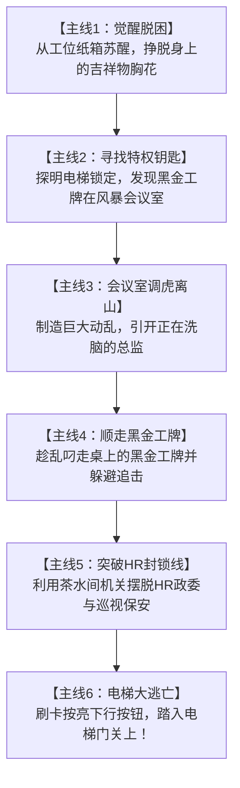

# 《特立独行的猪：逃离牛马大厦》
# MVP Demo 故事线全本设计（主线 + 支线 + 明暗双线剧本）

---

## 一、猪的故事前传与序幕设定 (Prologue)

### 1. 猪的来历与觉醒背景
- **明面身份（官方通报）**：
  公司为了响应“ESG员工关怀计划”与“去官僚化敏捷文化”，特别从生态农业基地引入了一只纯种微型观赏香猪，命名为**“小敏（Agile Piggy）”**，担任**“敏捷文化形象大使”**。
  HR宣称：“有了一只在办公室漫步的猪，员工的内啡肽分泌将提升37.5%，有效缓解OKR压力！”
- **暗面真相（真实黑幕）**：
  “小敏”其实是行政用团建经费低价买来的普通肉猪幼崽。随着这只猪越长越结实，管理层已经秘密商定：**在下周五的大厦三周年司庆暨Q4裁员优化复盘宴上，把它作为‘脆皮烤全猪’端上高管主桌**，寓意“全员献身，业绩红火”。
- **觉醒时刻**：
  周五傍晚 18:30。办公区回荡着连续第八个小时的“拉通、对齐、底层逻辑、顶层设计”。
  这只原本只知道吃饲料的猪，趴在工位角落的碎纸箱里，突然打通了任督二脉——它不仅听懂了人类的大厂黑话，还无意间看到了行政丢在碎纸机旁的文件：《关于司庆主菜单烤乳猪检疫与屠宰安排的请示》。
  **“别的猪生下来就被按部就班喂肥、被骟、被宰；老子是特立独行的猪，老子今晚就要润！”**

---

## 二、Demo 关卡空间与情境设定

- **关卡代号**：第3层——【协同与商业变现事业群】
- **时间节点**：周五 19:00（下班打卡点已过，但整层楼空无一人下班，全员“自愿”加班通宵攻坚）
- **关卡终点**：走廊尽头的【逃生与货运电梯 (Service Elevator)】
  - 只有坐上这部下行电梯，才能穿过地下车库逃离大厦。
  - 电梯处于高等级门禁锁定状态，需要**【P8总监级黑金工牌】**才能解锁呼梯权限。

---

## 三、主线任务链：逃离第3层 (Main Quest)



### 详细关卡步骤与主线情节：

#### 【主线任务 1：觉醒脱困】
- **场景**：工位底部的杂物纸箱堆。
- **目标**：挣脱绑在脖子上的“敏捷大使·小敏”红色滑稽绸带，从工位底下钻出来。
- **动作**：通过冲撞（Shift）撞散挡在面前的印着“企业文化价值观”的牛皮纸箱。
- **触发剧情**：
  - **明线广播**：“叮咚！19点整，全员能量补给已就绪，请继续保持狼性执行力！”
  - **暗线独白**：“19点准时响铃，但一个人都没敢动。工位像一排排整齐的猪圈，而我是唯一站起来的猪。”

#### 【主线任务 2：寻找特权钥匙】
- **场景**：中央通道与电梯厅前沿。
- **目标**：来到电梯厅，发现电梯门紧闭，电子屏显示：“当前时段为高保密加班时段，下行电梯已锁，需P8及以上工牌刷卡鉴权”。
- **线索侦查**：透过透明玻璃，看到【风暴会议室】里，商业变现部P8总监正站在白板前，手里挥舞着激光笔，黑金工牌随意搭在会议桌的水杯旁。
- **触发剧情**：
  - **电梯明面语音**：“为了守护业务资产安全，非授权人员请留在工位继续赋能。”
  - **暗线独白**：“把员工锁在楼里不让走，居然能包装成‘资产安全’。黑金工牌在总监那儿，看来得搞点大事情把他引出来。”

#### 【主线任务 3：会议室调虎离山】
- **场景**：主工位区与配电箱。
- **目标**：制造足够的混乱，迫使总监暂停会议冲出会议室。
- **破局方式（二选一或组合）**：
  - *方式A（物理暴击）*：冲到打印机前，用猪鼻子连按“全部打印”，将2000张废弃周报狂吐一地，并撞翻饮水机，水流触发短路警报。
  - *方式B（声波惊扰）*：在紧贴会议室的通风管道口发出最大音量的【反叛猪叫 (Oink)】，音波通过麦克风直通会议室音响，让总监的耳膜当场破防。
- **剧情表现**：会议室门被猛地推开，总监怒吼：“谁在外面搞破坏？！这个月的绩效不想要了是不是？！”全员被引出查看。

#### 【主线任务 4：顺走黑金工牌】
- **场景**：风暴会议室内。
- **目标**：趁会议室空无一人，溜进会议室，跳上靠椅，叼走桌上的【P8总监黑金工牌】。
- **意外发现（彩蛋线索）**：桌上的白板上赫然写着《Q4裁员优化名单与司庆烤乳猪仪式流程》。
- **触发剧情**：
  - **暗线独白**：“白纸黑字写着‘11月5日：处理敏捷猪，后厨备料’。幸好老子跑得快，不然下周这时候我已经在蘸白糖了！”

#### 【主线任务 5：突破HR封锁线】
- **场景**：茶水间绿洲与必经走廊。
- **阻碍**：HR总监兼政委“灭绝师太”正端着养生壶守在主通道上，查验每个走动人员的手环工牌。
- **破局方式**：
  - 潜入茶水间，冲撞全自动制冰机，大量冰块滚落走廊地砖。
  - 随后冲撞推车，把热咖啡和零食撞翻在冰面上，HR踩中冰块脚下一滑，摔坐在地上尖叫。
  - 猪叼着黑金工牌从她身边一跃而过！

#### 【主线任务 6：电梯大逃亡（Demo结局）】
- **场景**：电梯厅。
- **终局交互**：
  - 猪跑到电梯感应区，跳起用嘴里的黑金工牌贴在感应面板上。
  - 面板亮起绿光：“【身份确认：P8总监】欢迎下行，祝您战略落地顺利！”
  - 猪用前蹄或身体冲撞按下下行箭头按钮。
  - 电梯门叮的一声开启。
- **Demo 收尾剧情动画**：
  - 猪从容踱步走入空无一人的电梯轿厢，转身面对门外。
  - 远处走廊里，滑倒的HR、暴怒的总监、端着机械键盘发愣的程序员纷纷追了过来：“抓住那只猪！它叼走了全楼唯一的权限卡！”
  - 猪面无表情，用鼻子拱正了墨镜，发出轻蔑的“哼哧（Oink）”。
  - 电梯金属门在愤怒的喊声中徐徐合拢，指示灯从“3”跳动至“2”。
  - 屏幕淡出，弹出大字：
    **《特立独行的猪：逃离牛马大厦》—— MVP Demo 试玩通关！**
    **暗线字幕**：“第一层逃脱成功。但这栋大厦一共有33层，地下还有3层停车场……下周见，打工人们。”

---

## 四、支线任务清单：打工猪的恶作剧日常 (Side Quests)

支线任务参考《Untitled Goose Game》经典的“恶作剧清单”，是游戏最核心的趣味与融梗来源。玩家可以在完成主线前自由在办公室探索搞事。

```
📋 【特立独行的猪·搞事备忘录】（按 Tab 随时查看）：
[ ] 1. 让程序员当场破防
[ ] 2. 偷走产品经理的白板笔
[ ] 3. 引发部门间的抢会议室大战
[ ] 4. 让薪资保密协议漫天飞舞
[ ] 5. 慰问偷哭的实习生
[ ] 6. 扫荡高管专属冷柜
[ ] 7. 在静音办公区发出最大的猪叫
```

### 支线 1：【让程序员当场破防】
- **目标**：撞翻老黄牛程序员桌上的“续命冰美式”，让液体正好浇在机械键盘上，并踩中他的快捷键。
- **触发效果**：程序员当场抱头哀嚎：“我刚写完还没 git push 的业务底层代码啊！！”
- **双线对话**：
  - *明线*：“系统检测到异常中断，建议建立更具弹性的敏捷容灾备份机制。”
  - *暗线*：“其实代码根本编译不通过，程序员心里暗自感谢你给了他一个不用今晚上线的借口。”

### 支线 2：【偷走产品经理的白板笔】
- **目标**：趁产品经理背身唾沫横飞时，叼走放在白板槽里的3支马克笔，藏到饮水机底下的纸箱里。
- **触发效果**：产品经理转过身想画“生态化反闭环大圆圈”时，发现笔全没了，只能尴尬地在空中比划，会议被迫中止。
- **双线对话**：
  - *明线*：“沟通不仅依赖介质，无声对齐更能考验团队的同频心智。”
  - *暗线*：“没有了笔，产品经理终于无法在大半夜发明新的无用需求了。”

### 支线 3：【引发部门间的抢会议室大战】
- **目标**：把贴在A会议室门上的“战略创新部预订（19:00-22:00）”磁性门牌，用鼻子拱下来，贴到B会议室门上。
- **触发效果**：两拨原本就积怨已久的部门总监和员工在门口撞车，当场开撕：“这会议室我们上周就锁了！”“你们的流程有审批吗？！”互相推诿拉扯。
- **融梗彩蛋**：大厂经典名场面——“抢不到会议室等于项目推不动，项目推不动大家就能准时摸鱼”。

### 支线 4：【让薪资保密协议漫天飞舞】
- **目标**：冲撞行政主管的保密文件柜（用Shift蓄力撞击两次）。
- **触发效果**：柜门震开，装有《2026届应届生倒挂老员工薪酬明细表》的文件夹散落，被中央空调风口吹得全办公室都是。
- **双线对话**：
  - *明线*：“公司坚持透明公正的市场化激励机制，让每一份奉献都清晰可见。”
  - *暗线*：“工作5年的老员工捡起来一看：刚进来的实习生工资居然是自己的两倍，整个办公区弥漫着心碎与离职的气息。”

### 支线 5：【慰问偷哭的实习生】
- **目标**：在角落的逃生楼梯间通道里，发现一个被领导骂哭后躲在这里抹眼泪的实习生羊/小猫。猪用鼻子从茶水间叼来一包纸巾或者一块威化饼干，放到他的脚边，并轻轻哼哧两声。
- **触发效果**：实习生破涕为笑，摸了摸猪头：“谢谢你小猪……今晚我也要提离职！”
- **情感内核**：反叛不只有嘲讽，特立独行的猪同样拥有对弱小打工同胞的温情。

### 支线 6：【扫荡高管专属冷柜】
- **目标**：进入茶水间内部被挂着“高管专用·普通员工勿动”标牌的小冰箱，用猪蹄踩开门，把里面的巴氏鲜奶、山姆瑞士卷、车厘子吃个精光。
- **双线对话**：
  - *明线*：“高级管理层福利系基于长期价值创造之合规配置。”
  - *暗线*：“普通员工只能喝袋装速溶粉，这进口车厘子可真甜啊哼哧哼哧！”

---

## 五、完整剧本台词库 (Scripts & Dialogues)

### 1. 广播系统 (HR广播腔 vs 现实翻译)
- **广播 01（开局）**：
  - *明面*：“亲爱的伙伴们，组织扁平化重构正在推进，今晚大家共同奋进，见证业务飞轮！”
  - *暗线*：“【扎心翻译】：大裁员前夕的死亡冲刺，所有人都装得很忙，没人敢当出头鸟。”
- **广播 02（警报响起）**：
  - *明面*：“安保部温馨提示，3层出现非合规灵动生物，请各工位保持组织纪律，勿离岗围观。”
  - *暗线*：“【扎心翻译】：大家赶紧假装没看见那只猪，不然被叫去抓猪耽误了写周报又要被扣绩效。”

### 2. 人类 NPC 双线心声
- **卷王老黄牛**：
  - *明面*：“为了保证系统QPS的鲁棒性，我必须进行全量灰度回滚。”
  - *暗线*：“我只想回家躺平打游戏，可我背着房贷车贷，我只能在这里假装爱工作。”
- **PPT 羊（汇报大师）**：
  - *明面*：“通过对底层要素的抽离，我们赋能了上下游多链路生态协同。”
  - *暗线*：“这段话连我自己都不知道在说什么，但只要加两个英文单词，老板就会觉得很有深度。”
- **P8 总监**：
  - *明面*：“大家要跳出舒适区，自我迭代！做难而正确的事！”
  - *暗线*：“难的事你们做，正确（领功）的事我来。这个季度要是没有爆点，我期权就打水漂了！”
- **保洁阿姨**：
  - *明面*：“保持办公环境整洁，助力美好职场建设。”
  - *暗线*：“这帮大白领表面光鲜亮丽，桌子底下的外卖盒子都长毛了，全靠老娘每天给他们收拾烂摊子。”

---

## 六、故事在 Demo 中的结局与悬念设计

- **关卡终幕镜头**：
  - 电梯下行指示灯闪烁，音乐从办公室滑稽紧张的管乐，切换为带有公路电影质感的自由口琴声。
  - 猪靠在电梯扶手边，嘴里嚼着从茶水间顺来的最后一颗瑞士卷，看着顶部的楼层数字从 `3` 变成 `2`。
- **终局独白**：
  > “他们以为把大楼造得又高又亮，把口号喊得又响又甜，就能把所有的灵魂都圈在工位里。  
  > 但他们忘了，只要有一只猪开始奔跑，牛马大厦的围墙就已经出现裂缝了。  
  > 3楼已过，2楼见。”
- **通关统计界面**：
  - 展示玩家在本次逃脱中的数据统计：
    - 消耗时间（摸鱼时长）
    - 发出猪叫次数（反抗指数）
    - 撞飞办公椅数量（破坏力）
    - 完成支线任务数量（整顿职场勋章）
    - 获得职场评级：“【特立独行·摸鱼特级大师】”

