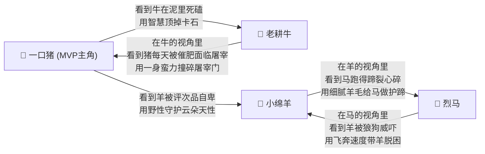

# 《一口猪在金牌农场》故事全本策划案
## 核心设定：悬崖边的箱庭世界 · 多视角交织的“围城”寓言

---

## 一、作品核心定位与命名

- **正式作品名**：《一口猪在金牌农场》
  - **“一口猪”**：西南与民间乡野最质朴、最地道的叫法。没有故作高深的修饰，带着泥土的气息与生命的原初韧性。
  - **“金牌农场”**：现代标准化规训的代名词。金牌认证、金牌产出、金牌指标……用一块虚幻的金牌，把所有的牲畜牢牢套在原地。

---

## 二、全景叙事网络：“围城”多视角互助系统 (Grand Vision)

> **“你在桥上看风景，看风景的人在楼上看你。”**  
> 整个故事发生在**同一个箱庭场景**（悬崖边的金牌农场）。玩家选择哪个动物，就是以该动物的眼睛去重新阅读整个世界。



### 1. 视角互为镜像的“围城”机制
- **选择哪个角色，哪个角色在当前周目就摆脱了自身视角的局限，成为“清醒的破局者”**：
  - 在**猪的视角**里，猪是清醒自在的，它看不到自己被杀的既定宿命，而是看到阿牛在泥地里拼命拉犁、绵绵因羊毛不够硬而哭泣，于是猪去用它的智慧点醒它们；
  - 在后续的**牛的视角**里，牛其实并不觉得自己辛苦，牛反而心疼猪：“那口猪真傻，吃了睡睡了吃，它不知道下个月司庆它就要被端上桌了！我得用我的牛角去帮它顶开屠宰场的大门！”
  - 在**马的视角**里，马觉得自己跑得快很威风，但它看到羊因为太柔弱总被欺负，于是马用它的速度去庇护羊；而在**羊的视角**里，羊羡慕马能奔跑，却心疼马每天在泥圈里跑得蹄子流血……
- **多视角的哲学收获**：
  A 羡慕 B，B 也羡慕 A；局内人迷惘，旁观者清醒。真正打动人心的不是冗长的哲学说教，而是**极简短、极有力、切中生活实质的一两句话**。

---

## 三、箱庭空间设计：悬崖边的金牌农场 (The Cliffside Farm)

```
                       [ 广袤群山与辽阔天空 ]
                                 ▲
                     ════════════索道木缆车════════════
                    ║                                ║
       ~~~~~~~~~~~~~万丈悬崖绝壁 (CLIFF EDGE)~~~~~~~~~~~~~
      ▲ [老岩羊跳上来的崖口]
      │
   【猪舍后院】(一口猪的起点，泥土与麦垛)
      │
      ▼
   【中央作业泥垄】──►【老牛阿牛的耕作区】(卡住顽石的深犁)
      │
      ▼
   【矮木羊舍】────►【小绵羊绵绵的草垛】(挂着次品木牌)
      │
      ▼
   【环形跑道】────►【烈马追风的跑圈】(封闭的木围栏)
      │
      ▼
   【农庄正门前道】──►【管家犬老张的铜铃与名册】
```

### 1. 核心地理巧思：悬崖边的猪舍与老岩羊
- **悬崖与猪舍**：猪舍就建在农场最边沿的后山万丈悬崖边上，崖风凛冽，抬头就能看到落日与云海。
- **神级引路人——老岩羊**：
  - 为什么农场的管家犬和铁丝网抓不到它？
  - **因为它是从万丈悬崖底下如履平地般跳上来的！**
  - 它不需要翻农场大门，悬崖就是它的坦途。它能在悬崖边探出头，和猪、和牛、和马合理地对话交流，传授生存经验，而农场的规训网对它无可奈何。

---

## 四、MVP 第一篇章：一口猪在金牌农场 (完整剧本)

### 【序幕：悬崖边的晨风与老岩羊】
- **场景**：悬崖边的猪舍废墟，微风拂动荒草。崖下是深不见底的云雾。
- **事件**：一只角如弯刀、白胡须随风飘扬的老岩羊，从悬崖下的岩石上轻盈一跃，稳稳落在猪舍残墙上。
- **简短有力的对话**：
  - **老岩羊**：“猪，你天天看天，天里有包子？”
  - **一口猪**（嘴里叼着干麦穗，打了个哈欠）：“天里没有包子，但天足够大。”
  - **老岩羊**（笑了笑，用羊蹄踢过去一枚生锈的古索道插销）：“农场的金牌是给死肉戴的。真想奔大地方，顺着崖边的缆车下去。不过走之前，大院里那几头傻口子，快被那块金牌压断骨头了。”
  - **一口猪**：“知道。吃饱了，顺路给他们松松绑。”

---

### 【第一幕：黑土地里的笨石头 (老牛阿牛)】
- **场景**：泥泞深陷的黑土垄。老黄牛阿牛拉着深犁，四蹄发抖，泥浆溅满全身，眼珠子通红，嘴里吐着白沫：“还差两分地……今天翻不完，金牌评优就黄了……”
- **动作**：一口猪踱步走过去，低下坚硬的猪鼻梁，对准犁尖下面猛力一拱！
  **“咔嚓！”** 一块磨盘大的死黑石被直接拱出了泥垄，咕噜噜滚进排水沟。
- **极简有力的点拔**：
  - **阿牛**（呆住）：“……石头？我顶着块大石头犁了半天？！”
  - **一口猪**（抬眼看着老牛）：“阿牛，地是翻不完的，但牛会累死。”
  - **阿牛**：“可金牌农场的规矩……”
  - **一口猪**：“规矩是人定的，命是爹妈给的。地每年都要歇冬，你比地还硬？”
- **阿牛的顿悟**：阿牛站在泥垄里，长长吐出一口白气。它看了看滚远的石头，突然笑了，自己用牛角顶开了脖子上的硬套：“对，老子今天不翻了。喝水去！”

---

### 【第二幕：草垛里的细羊毛 (小绵羊绵绵)】
- **场景**：低矮的羊舍角落。刚被剃了毛的小绵羊绵绵缩在麦草堆里发抖。木栏上贴着刺眼的红字：**【次品羊毛：细软无力，不合标准】**。
- **动作**：猪走上前，顺脚踢飞了木牌，用鼻子从地沟边推过来一颗带泥的新鲜野胡萝卜，放在小羊蹄边。
- **极简有力的点拔**：
  - **绵绵**（抽抽搭搭）：“阿猪叔……他们说我的毛织不成厚布，我是最没用的一头羊……”
  - **一口猪**（嚼着嘴里的麦穗）：“天上的云硬不硬？”
  - **绵绵**（愣了愣）：“……云是软的。”
  - **一口猪**：“云就是软的，才好看。羊毛软，是你的本事，不是你的病。他们要硬布做麻袋，那是他们没见过云彩。”
- **绵绵的顿悟**：绵绵一口咬下胡萝卜，甜脆的汁水在嘴里散开。它抹干了眼角，眼珠子亮得像两颗露珠：“云彩……对，我长的是云彩毛！”

---

### 【第三幕：跑圈里的瞎马 (烈马追风)】
- **场景**：金牌农场的环形表演赛道。烈马追风戴着黑皮眼罩，在窄小的椭圆圈里踏踏狂奔，全身汗如雨下。
- **动作**：一口猪瞅准追风减速的拐角，猛地一头拱烂了弯道的木护栏，坚硬的牙齿精准咬住了追风脸上的眼罩带子，用力一扯！
- **极简有力的点拔**：
  - 眼罩脱落，追风眼前猛地刺亮，失控急刹。它瞪大马眼看着四周——只有一条五十米长的泥圈，自己在里面踩出了深槽。
  - **追风**（浑身发抖，声音发虚）：“我……我跑了整整三年……我每天跑一百里，原来就在这泥圈里打转？！”
  - **一口猪**：“迈开腿谁都会，往哪跑才是本事。围栏烂了，外面才是路。”
- **追风的顿悟**：烈马长嘶一声，不再低头看脚下的泥槽，而是抬头望向了悬崖外连绵不绝的苍山。

---

### 【第四幕：大院当中的破铜铃 (管家犬老张)】
- **场景**：通往后山索道的必经石板路上。管家犬老张脖子上挂着硕大的铜铃铛，手里捏着金牌名册，气喘吁吁地挡在路中间。
- **极简有力的交锋**：
  - **老张**（咬牙切齿晃铃铛）：“阿猪！回头！农场今年评上了特级金牌！只要你留下来，金铃铛给你戴，高蛋白豆饼管饱！你跑去悬崖，连口馊料都没有！”
  - **一口猪**（静静看着它，麦穗在晚风中轻轻晃荡）：“老张，金牌能嚼得动吗？”
  - **老张**（一愣）：“什么？！”
  - **一口猪**：“嚼不动，咽不下，戴在脖子上还硌得慌。槽里的豆饼再甜，也是买你这条命的定金。野地里的草根苦，但嚼碎了是自由的味儿。”
  - **老张**（脸色惨白，声音发颤）：“可……不守着这农场，我算什么东西？”
  - **一口猪**：“算一条长了四条腿、能在草地上撒欢的活狗。”
- **老张的动摇**：老张呆立在石板路上。猪从它身边坦然走过，带起一阵清凉的山风。老张低头看着爪子里的金牌，脖子上的铜铃第一次不再发出清脆的响声。

---

### 【终幕：悬崖缆车，驶向人间】
- **场景**：后山悬崖边缘。古老的木质缆车静静悬挂在两根横跨峡谷的粗钢索上。落日把整个山谷烧成一片通红。
- **动作**：
  - 一口猪迈上悬崖凸出的木栈道，伸出硬拱嘴，把生锈的铜插销狠狠撞进了缆车卡槽！
  - 齿轮轰鸣转动，吊厢门咯吱滑开。
- **回望金牌农场**：
  - 猪站在吊厢边缘回头看去——
  - 阿牛卧在溪边悠闲地甩着尾巴嚼草；绵绵站在草堆最高处，把柔软的白毛迎着晚风抖成一朵云；追风踏碎了所有围栏，在悬崖草甸上放开四蹄狂奔；老张坐在大门口，那枚纯铜铃铛已经被它扔进了路边的水洼。
- **吊厢滑出**：
  - 吊厢载着这一口特立独行的猪，徐徐滑向悬崖之外辽阔无垠的金色大地。
- **终屏金句**：
  > **“金牌是农场的，但命是你自己的。”**  
  > **“世上只有一种特立独行：看清了槽里的把戏，依然坦坦荡荡奔向旷野。”**  
  > **“一口猪走出了围城；天地很大，下山见。”**
