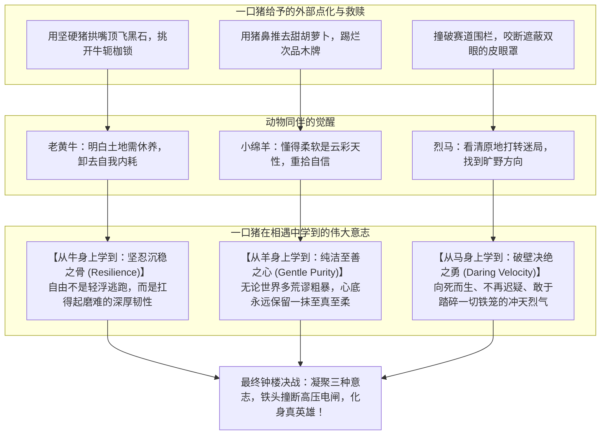

# 《一口猪在金牌农场》史诗故事全本 (汲取意志与英雄蜕变版)
## 空间设定：悬崖在下方，自下而上进发的突围之旅
## 核心人物关系：素昧平生的相遇 · 给予救赎 · 汲取意志 · 灵魂蜕变

---

## 一、核心设定：从“全知老友”到“沿途相逢的灵魂共振”

### 1. 素昧平生：猪原本并不认识任何动物
- 在金牌农场严苛的网格化管理中，不同牲畜被严格隔离在各自的区域（猪舍、耕作垄、羊圈、赛道），彼此老死不相往来。
- 这口猪自生下来就呆在屏幕下方最边缘的悬崖破猪圈里。它只见过天天抢饲料的同类，听过远处传来的劳作声，**它在路上遇见的牛、羊、马，全都是素昧平生的陌生生灵**！
- 没有先入为主的熟人寒暄，只有一次次在绝境边缘被震撼的陌生相逢。

### 2. 双向救赎：给予帮助，更从它们身上学到新的意志
英雄从来不是高高在上的施舍者，真正的英雄在旅途中从同伴身上照见自我、汲取力量，完成灵魂的拼图：

---

## 二、一口猪视角下的“英雄之旅”完整十二阶段长篇剧本

### 【第一幕：启程 (Departure)】

#### 阶段 1：平凡世界 (The Ordinary World)
- **情景**：屏幕正下方，悬崖边残破萧条的旧猪圈。
- **常态**：晨雾笼罩深渊。这口猪在烂泥边冷眼看着同类为了甜食槽争吵。它嘴叼麦穗，敏捷地跳上悬崖边的半截残石墙，看翻涌的云海。它生来敏捷机警，却也带着一丝漂泊者的玩世不恭，对一切冷眼旁观。

#### 阶段 2：冒险召唤 (Call to Adventure)
- **事件**：一只角如残月的老岩羊，伴随碎石声，**从屏幕正下方的峭壁深渊下轻巧一跃跳上残墙**。
- **对话**：
  - 老岩羊：“猪，你天天看天，天里有包子？”
  - 猪（吐了口唾沫）：“天里没包子，但天足够大。”
  - 老岩羊冷笑：“农场的金牌是给死肉戴的。司庆要到了，你这口猪就是头道硬菜。”

#### 阶段 3：拒斥召唤 (Refusal of the Call)
- **内心退缩**：
  - 猪看着脚下的万丈绝壁，又回头看了看猪圈里温热的水坑。
  - “悬崖出去是狼群和冻土，留在泥坑里，至少有口温料能填饱肚子。”
  - 习惯了温饱的身体本能地恐惧未知的严酷，猪在泥地里退缩徘徊。

#### 阶段 4：遇见导师 (Meeting the Mentor)
- **赠物与箴言**：
  - 老岩羊用羊蹄踢过一枚生锈的古索道铜插销。
  - > “孩子，世上最惨烈的不是死在悬崖下，而是你在泥坑里被骟了灵魂，临到上了案板，还当那是主子的恩赏！  
    > 索道在最上方的后山，插销给你。顺着一路向上闯，路上的凶险你得自己扛。”

#### 阶段 5：跨越第一道边界 (Crossing the First Threshold)
- **动作**：猪叼起铜插销，浑身血液发烫。它决然掉头，前蹄猛蹬，坚硬如铁的猪拱嘴对准通向大院的厚重木门栓狠狠一拱——**咔嚓！木栓粉碎！**
- 猪正式离开屏幕下方的舒适圈，向屏幕上方未知的大院腹地挺进！

---

### 【第二幕：启蒙与试炼 (Initiation)】

#### 阶段 6：考验、盟友与敌人 (陌生相遇与意志汲取)

##### 试炼一：黑土泥垄的陌生老黄牛 ➔ 汲取【坚忍之骨】
- **相遇**：
  向上穿过杂草，猪来到深陷泥泞的黑土耕作区。
  这是它这辈子第一次见到牛——一头如铁塔般庞大却瘦骨嶙峋的老黄牛。深犁死死卡在泥中，老黄牛四蹄在黑泥里刨出了血窟窿，嘴角白沫狂涌，却依然咬牙死命往前蹬。
- **震撼**：
  猪看呆了。它从未见过如此纯粹、如此深厚、哪怕粉身碎骨也不愿后退半步的生命韧性！
- **猪的帮助**：
  猪冲上去，硬鼻梁对准犁尖下方猛力一挑——**轰！一块磨盘大的死黑石被挑飞翻出垄沟！** 猪用下巴挑断了磨破皮肉的颈套。
- **简短有力的真理点化**：
  - 老牛（大口喘粗气，呆住）：“……你是一口猪？这石头……我犁了半天？可金牌农场的指标……”
  - 猪（第一次认真地看着它）：**“地是翻不完的，但牛会累死。连黑土地每年都要歇冬，你比地还硬？”**
  - 老牛怔怔看着滚远的石头，突然笑了：“规矩是人定的，命是自己长出来的。老子今天不翻了，喝水去！”
- **猪学到的意志【坚忍之骨 (Resilience)】**：
  老黄牛即使在泥潭绝境中也不曾弯下的脊梁，深深烙印在猪心里。猪第一次明白：**自由不是轻佻的逃跑，要想穿过这片戒备森严的高墙，必须拥有像老牛一样深厚沉稳、敢扛千钧的坚忍之骨！**

##### 试炼二：羊圈草垛里的陌生小绵羊 ➔ 汲取【温柔之心】
- **相遇**：
  继续向上穿行，猪在矮木羊舍的阴暗角落里，听到了一阵细微弱小的抽泣声。
  走近一看，是一只刚被剃光了毛、冻得瑟瑟发抖的小绵羊。木栏上贴着刺眼的红印：【次品羊毛：细软无力，工业报废】。小绵羊缩在草堆里，觉得自己是全天下最丑、最没用的累赘。
- **震撼**：
  在这座冷酷讲求斤两与硬度的机器农场里，这只小羊的眼神却干净得像山泉，面对饥寒，它甚至还小心翼翼地护着草堆里一窝刚孵化的小雀。
- **猪的帮助**：
  猪一蹄子踹烂次品木牌，用湿润的鼻子从地沟边拱出一根新鲜脆甜的野胡萝卜，推到小羊嘴边。
- **简短有力的真理点化**：
  - 小羊（抽泣）：“阿猪哥……他们说我太软了，我是不是生来就是个错？”
  - 猪：**“天上的云硬不硬？云就是软的才好看。羊毛软是你的本事，不是你的病。他们要硬布做麻袋，那是他们没见过云彩。”**
  - 小羊咬下胡萝卜，眼睛弯成了明亮的月牙：“原来柔软不是病啊……谢谢你阿猪哥！”
- **猪学到的意志【温柔之心 (Gentle Empathy)】**：
  小羊哪怕自身受尽嫌弃，却依然护着小麻雀的那份至真至柔，彻底融化了猪心中的防备与冷刺。猪学会了：**反抗不是让自己变成冰冷的顽石，而是不管世界多么粗暴荒唐，永远在心底保留一抹对弱小生命的温柔与慈悲！**

##### 试炼三：跑道泥圈里的陌生烈马 ➔ 汲取【决绝之勇】
- **相遇**：
  再往上走，是封闭的环形赛道。
  一匹神骏威武的黑色烈马，脸上套着蒙眼的黑皮套，在一条五十米长的椭圆泥圈里疯狂狂奔。蹄铁在石头上擦出道道火星，它大汗淋漓，却以为自己正在大草原上领跑群伦。
- **震撼**：
  那种体内沸腾的狂暴热血、向死而生的奔腾气势，让猪浑身的汗毛倒竖！
- **猪的帮助**：
  猪瞅准拐角，猛力一头撞烂看台木护栏，扑上去借力一口咬断烈马脸上的眼罩皮扣！
- **简短有力的真理点化**：
  - 眼罩脱落，烈马猛然勒住长缰，惊骇四顾：“我跑了三年……原来一直在五十米泥圈里踩自己的蹄印？！”
  - 猪：**“迈开腿谁都会，往哪跑才是本事。围栏烂了，悬崖外才是路！”**
  - 烈马仰天长啸，一脚踢烂终点金牌牌匾：“原地打转的荣耀，一文不值！阿猪，今天谁敢拦你，我的铁蹄踏碎他们的门！”
- **猪学到的意志【决绝之勇 (Daring Velocity)】**：
  烈马长啸破空的决绝霸气，彻底扫空了猪心头最后一丝畏缩。猪学会了：**面对前方的绝壁高塔，不再有片刻退缩与苟安，唯有一往无前、踏碎一切桎梏的滔天勇气！**

#### 阶段 7：接近最深洞穴 (Approach to the Inmost Cave)
猪一路自下而上，集齐了牛的坚忍、羊的温柔、马的决绝。
它终于抵达了屏幕正上方的中央红砖钟楼——只有切断全区总高压电闸，悬崖索道的电磁锁扣才能松脱。

#### 阶段 8：严峻生死考验 (The Ordeal)
- 陷阱被触发！巨大的粗钢丝捕兽网轰然坠落，将猪死死网在钟楼冰冷的大理石上。
- 管家犬老张率领十二只巡逻杜宾犬封死了所有出口。
- 老张晃着刺耳的纯铜铃铛，把一枚沉甸甸的纯金模范项圈扔在猪眼前：
  “阿猪，庄园主给你最后一条生路！戴上这枚金项圈，做全庄五星级种猪标兵，细料管饱！否则，明早后厨开膛剔骨！”
- 锋利的屠刀与闪光的金项圈同时逼在眼前。

#### 阶段 9：夺取真理之剑 (The Reward)
- **三种意志的终极爆发**：
  猪没有发抖。
  牛教给它的坚忍让它顶住捕兽网的重压，羊教给它的纯真让它一眼看穿金牌的虚伪，马教给它的决绝让它爆发出惊天动地的力量！
  “金牌能嚼得动吗？嚼不动，咽不下，戴在脖子上还硌得慌！”
  猪发出一声如雷贯耳的长鸣，借力弹跳，坚硬如铁的猪拱嘴狠狠撞在墙壁上的全区高压总电闸上！
  **轰！电弧飞溅！全庄探照灯、电网、广播喇叭瞬间断电熄灭！**
  喧嚣退场，浩瀚璀璨的银河毫无保留地洒满人间！

---

### 【第三幕：归途与重生 (Return)】

#### 阶段 10：返回之路 (The Road Back)
- 黑暗中，全庄动物在星空下彻底觉醒！
- 猪钻出铁网，自下而上向着最上方的后山索道发起最后的冲锋！
- 犬队试图合围，但在冲锋的石道两侧：
  - **老黄牛用坚韧的身躯死死抵住了捕兽大网**；
  - **小绵羊带领全群羊如白云般密不透风地截断了追击通道**；
  - **烈马长嘶着踏碎了高耸的铁栅栏**！
- 曾经互不相识的生灵，在这一刻为了掩护一口猪的自由，筑起了不可动摇的英雄长廊！

#### 阶段 11：灵魂蜕变与复活 (The Resurrection)
- 猪冲上了屏幕最上方的悬崖索道崖口。
- 老张气喘吁吁追上来，瘫坐在地崩溃大哭：“指标没了，农场砸了……我们怎么活啊……”
- 猪在索道吊厢前停下步子，从草丛里挑出自己画的《引水渠自流通水图》，轻轻推到老张爪边：
  > “老张，引水渠我全拱通了，大地不需要鞭子，春天草自会发芽。  
  > 铜铃很响，但山风更大。别替笼子守门了，你也该卸下铃铛，去草地上打个滚了。”
- 老张老泪纵横，亲手解下了勒在脖子上十年的纯铜铃铛，扔进泥水。

#### 阶段 12：携灵药归来 (Return with the Elixir)
- 猪撞入生锈的铜插销，木质吊厢在夕阳熔金中滑出绝壁，向万顷原野飞驰而下！
- 猪前蹄搭在木栏上，麦穗在晚风中狂舞，清澈的眼里映着整片天地。
- 此时此刻，它不再是一只普通的猪——它拥有牛的坚忍、羊的纯真、马的决绝，它成了一个真正自由的生命图腾。
- **终屏金句**：
  > **“金牌是农场的，但命是你自己的。”**  
  > **“世上只有一种特立独行：看清了槽里的把戏，依然坦坦荡荡奔向旷野。”**  
  > **“一口猪走出了围城；天地很大，下山见。”**
