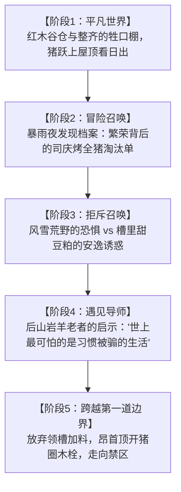
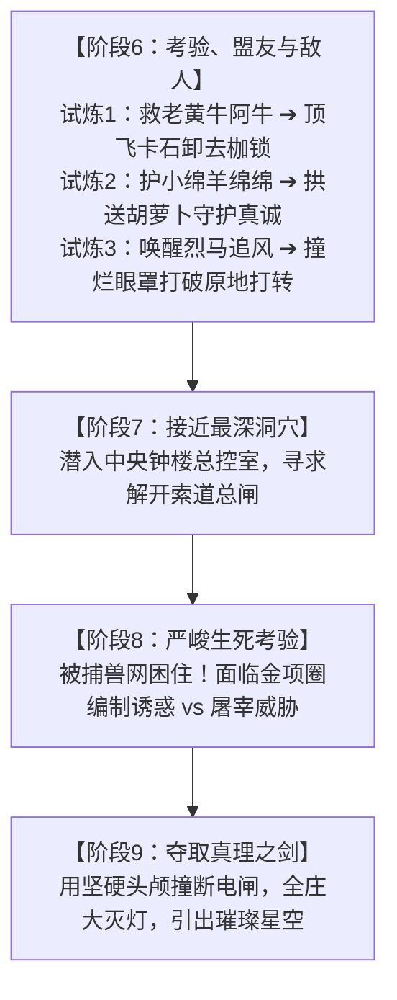
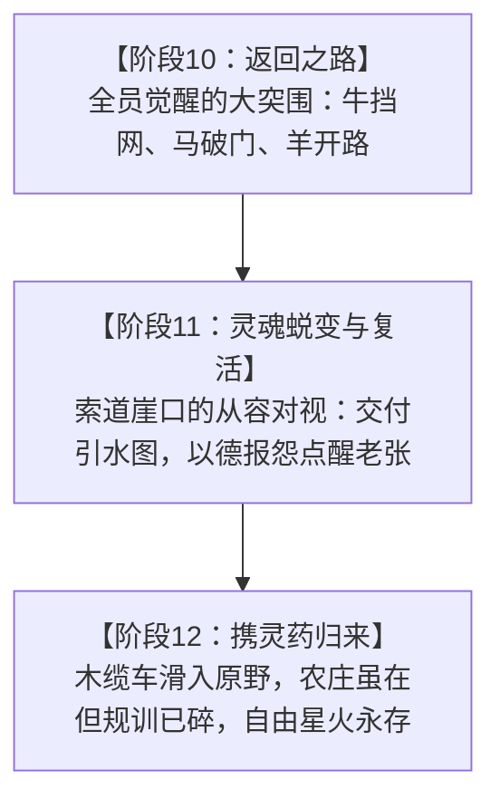

# 《特立独行的猪》史诗级寓言故事全本
## 架构：基于经典“英雄之旅” (The Hero's Journey) 的十二阶段宏大叙事
## 主题：在规训中坚守本真，在从容中重拾力量

---

## 序章：寓言世界观与精神母题

### 1. 舞台：新星模范生态农庄 (The Modern Farm)
在绵延的群山与广袤的原野交界处，坐落着一座名震四方的“新星模范生态农庄”。
这里有最先进的自动草料传送带、二十四小时监控体重的电子地磅、高音喇叭播报的生产节拍，以及挂在每一间棚舍门口的“五星级标兵流动红旗”。
农庄向外界宣称：“在这里，每一头牲畜都找到了自身生态链上的终极闭环与幸福归宿。”

然而，在这座整洁、高效、井井有条的现代化庄园内部，却运行着一套冰冷残酷的无形法则：
- **牛**生来就该拉犁，蹄子磨出血也必须赶在天黑前耕满定额；
- **马**生来就该戴上眼罩，在封闭的环形跑道上跑出漂亮的配速曲线；
- **羊**生来就该产毛，任何细软、不迎合工业粗毛毡标准的羊毛都被盖上“次品”烙印；
- **猪**生来就该吃睡，按部就班地催肥称重，等待在司庆盛典上成为案板上红彤彤的烤全猪。

所有动物都被困在“害怕被淘汰”的无休止内耗里，直到那只特立独行的猪打破了万籁俱寂的平静。

### 2. 主角：一头真正特立独行的猪 (The Maverick Pig)
它不是披着人类风衣的怪兽，**它是一头地道、活生生、四蹄矫健、皮肤粉润的黑白花斑猪**。
它长着像山羊一样轻灵有力的蹄子、一对扑棱的大耳朵、一截灵动打卷的小尾巴，以及一张拱起地来比铁铲还有劲的硬鼻梁。
嘴里常年斜叼着一根金黄色的干麦穗，眼神清澈而深邃，宛如漫步尘世的隐士。

---

## 第一幕：启程 (Departure) —— 破晓的觉醒

### 阶段 1：平凡世界 (The Ordinary World)
清晨五点半，全庄的高音喇叭准时奏响高亢激昂的《晨间奋进进行曲》。
喷淋系统喷洒出消毒水的气味，饲料传送带隆隆作响。成群的肉猪闭着眼睛挤在食槽前，为了一瓢加了香精的甜豆粕争得头破血流。
唯独它——这只特立独行的猪，早已经敏捷地跃上了高高的红木谷仓屋顶。
它迎着带露水的微风，站在公鸡风向标旁，平静地注视着东方天际线缓缓升起的朝阳，听着远山深处野天鹅的啼鸣。
农庄里的人和动物都觉得它是个怪胎，甚至私下议论它“脑子被门夹过”。但它不在乎，它嘴里叼着一根干麦穗，活得悠闲自得。

### 阶段 2：冒险召唤 (Call to Adventure)
入秋后的一个暴雨之夜。狂风刮断了高压电线，农庄总控室的自动化卷帘门被暴风掀开。
避雨的猪潜入总控室，意外在散落一地的文件夹中看到了一份盖着庄园主鲜红印章的秘密文件：
**《新星农庄三周年司庆生态全产业链闭环方案及淘汰牲畜处置细则》**。
在刺眼的白纸黑字上，赫然印着所有同伴的名字与最终归宿：
- 老耕牛阿牛，预计在翻完这季黑土后因韧带劳损送往皮革厂；
- 小绵羊绵绵，三次羊毛评定若仍未达标，下个月列入杂毛肉羊混批处理；
- 而它自己，名字被红笔重重圈出：“特级展位展示猪，司庆正日端上主桌，寓意全员奉献、红红火火”。

这一刻，冰冷的雨水打在猪脸上。它终于看清：所有的“模范标兵流动红旗”、所有的“科学配方饲料”，不过是将生命物化成数据的精致骗局。

### 阶段 3：拒斥召唤 (Refusal of the Call)
震撼过后，是排山倒海的本能恐惧。
离开农庄意味着什么？
后山是悬崖峭壁、野狼盘踞的原始黑森林。庄园里虽然到处是无形的锁链，但至少每天有避雨的棚舍、温热的水槽。
猪低头看着自己圆滚滚的肚子和粉嫩的四蹄，内心产生了强烈的退缩：
“我不过是一头猪。一头猪能对抗整座机械化农庄吗？我是不是该像别的同类一样，装作什么都不知道，把眼睛闭上，多吃两槽甜豆粕，浑浑噩噩地过完这辈子？”
整整三天，它趴在草垛里一动不动，甚至任由饲料槽空着，陷入了前所未有的精神内耗。

### 阶段 4：遇见导师 (Meeting the Mentor)
第四天黄昏，在农庄最偏僻的后山乱石堆边，猪遇到了一位隐居多年的老生灵——一只曾经从屠宰场逃出、断了一只角的年迈老岩羊“白须”。
老岩羊看着神情萎靡的猪，嚼着苦涩的野地黄连草，平静地说道：
> “孩子，世间生灵最惨烈的悲剧，从来不是饥饿或死亡。  
> 而是你在一个被设计好的笼子里活得太久，被磨掉了所有野性与尊严，甚至开始打心底里感激那只给你套上枷锁的手。  
> 王小波当年写过你们猪类的先祖：别的猪都被骟了，唯有它不仅能跳上房顶，还能学汽笛叫，连打枪的人都奈何不了它。  
> 不能飞的鸟不是真鸟，认命的猪就只能任人宰割。去后山吧，那里有一座当年林场留下的旧木索道，它是通往这片天地之外唯一的路。”

老岩羊用蹄子拨开干草，露出一枚早已生锈但坚硬无比的旧索道铜钥匙插销。

### 阶段 5：跨越第一道边界 (Crossing the First Threshold)
破晓时分，全庄的钟声再次刺耳地敲响。
管理人员敲着铁桶，吆喝所有动物去排队打卡称重领料。
这一次，特立独行的猪没有走向食槽。它在所有同类惊骇的目光中，当着巡逻犬的面，昂起坚硬无比的猪拱嘴，猛力一顶！
咔嚓！猪圈那根象征着数十年规训秩序的沉重橡木门闩被应声折断！
猪叼起麦穗，扬起四蹄，决绝地踏出了安全区，迈向戒备森严的庄园中心大院。

---

## 第二幕：启蒙与试炼 (Initiation) —— 泥潭中的觉醒同盟

### 阶段 6：考验、盟友与敌人 (Tests, Allies, and Enemies)

要想穿过广袤的庄园大院抵达后山索道，猪必须穿过三大核心作业区，直面三位深陷体制规训的同伴，并躲避管家犬巡逻队的围追堵截。

#### 试炼一：黑土泥潭与老黄牛阿牛 (耕作执念的救赎)
- **情境**：在暴雨冲刷后的黏重黑土地上，老黄牛阿牛的蹄子磨出了血，沉重的铁木大犁将它的肩胛骨勒得皮开肉肉烂。一块硕大的花岗岩死死卡在犁齿之间，阿牛在泥浆里疯狂打滑加练，眼珠通红：“还差两分地……我必须翻完！隔壁马圈今天跑了五趟长途，我翻不够三亩地，评优垫底被扣了精饲料，我怎么活啊……”
- **拯救与点化**：特立独行的猪冲上前，用坚硬的猪头顶开巨石，用下巴挑断套具。
  > “阿牛，低头看看你脚下！那块石头卡在犁刀里两个时辰了，你是在跟土地较劲，还是在跟心里的恐惧死磕？  
  > 连黑土地到了冬天都要封冻休养，你一头活生生的牛，何苦把自己当成不知疲倦的铁机器？  
  > 吃多吃少饿不死健壮的牛，把自己熬垮了，换来的只有更重的犁！卸了吧，去小溪边喝两口清水看看天！”
- **盟友缔结**：阿牛眼中的血丝散去，长舒白汽，郑重向猪点头，成为第一个暗中掩护它的同盟。

#### 试炼二：羊圈风暴与小绵羊绵绵 (守护原生细腻的真诚)
- **情境**：羊圈里，刚被剃得光溜溜的小绵羊绵绵蜷缩在阴暗墙角抽泣。栅栏上贴着刺眼的“三等次品羊毛”标签，督导员训斥她“毛质过于细软，缺乏工业强度，是对庄园资源的极大浪费”。绵绵陷入深深的自卑与绝望。
- **拯救与点化**：猪用湿润的鼻子顶正倒地的水槽，拱过去一根水嫩的甜胡萝卜和几片清凉薄荷。
  > “小羊，你知道为什么他们嫌你的毛太细软吗？  
  > 因为流水线只要千篇一律的粗毛毡，他们不懂得，天上的云朵本来就是柔软的。  
  > 你的毛柔软，是因为你天性细腻温存，对每一缕拂过原野的春风都怀着善意。那不是缺陷，那是造物主留给你最特立独行的印记！  
  > 别拿纺织厂的标尺来称量自己的灵魂，你的春天比这间棚舍辽阔得多！”
- **盟友缔结**：绵绵吃下胡萝卜，擦干眼泪，在晚风中第一次自信地挺起小小的胸膛。

#### 试炼三：封闭跑道与烈马追风 (打破盲目奔跑的名利迷局)
- **情境**：烈马追风是农庄里的明星，被蒙上了皮质眼罩，只能沿着一条被高压铁丝网围起来的椭圆形塑胶跑道疯狂冲刺。它浑身大汗淋漓，蹄铁磨损殆尽，却以为自己正在领跑世界。
- **拯救与点化**：特立独行的猪找准时机，借助斜坡猛力撞破跑道拐角的木质看台，精准咬断了追风脸上的皮眼罩！
  追风眼前突然大亮，它猛地勒住缰绳，惊骇地看着四周——它跑了整整三年、跑了上万公里，原来不过是在一个直径不到五十米的封闭泥圈里原地打转！它从未踏上过哪怕一寸真正的草原。
  > “追风，你奔跑的速度无人能及，但方向比奔跑更重要。  
  > 摘下眼罩，去后山的大草原吧，那里的风才配得上你的鬃毛！”
- **盟友缔结**：追风仰天长嘶，彻底掀翻了赛道围栏，成为突击核心。

### 阶段 7：接近最深洞穴 (Approach to the Inmost Cave)
后山索道的供电与总闸，被锁在农庄正中心耸立的古老红砖钟楼（控制塔）顶层。
管家犬老张已经察觉到了异样，带着整整十二只受过严苛训练的纯种杜宾犬巡逻队，将钟楼围得水泄不通。
夜幕降临，暴风雨再度酝酿。猪必须在没有照明的情况下，孤身潜入戒备森严的钟楼底层。

### 阶段 8：严峻生死考验 (The Ordeal)
在钟楼顶层配电房前，陷阱触发了！
巨大的钢丝捕兽网从天而降，将猪死死网在冰冷的大理石地面上。
巡逻犬迅速合围，露出森白的獠牙。
管家牧羊犬老张晃动着胸前沉重的纯铜大铃铛，手里夹着庄园主的最高通牒，缓缓走上前：
> “阿猪，看看你搞的乱子！阿牛不耕地了，绵绵不剪毛了，追风把赛道都踏平了！  
> 但庄园主仁慈，他念在你引水渠修得好，给了你最后一条生路：  
> 只要你当着全庄动物的面，穿上这件印着‘五星示范’的红色马甲，戴上这枚纯金打造的模范种猪项圈，在明天的司庆大会上宣誓‘服从庄园一切安排’，以后你每天有吃不完的精细豆粕，拥有全庄最高级的单间！  
> 否则……天一亮，后厨的屠宰钩子已经在等你了。是当一头荣华富贵的金铃猪，还是当案板上的一摊碎肉？你自己选！”

锋利的屠刀与金灿灿的项圈同时摆在猪的鼻尖前。
这是灵魂深处最极端的生死拷问——是用尊严和灵魂做抵押，换取苟活与虚荣；还是宁肯玉碎，也要保持本真？
猪深深吸了一口气，闭上眼睛，感受着窗外呼啸掠过山岗的晚风。
它突然笑了，嘴里的麦穗在狂风中笔直挺立。

### 阶段 9：夺取真理之剑 (The Reward)
它没有低头，也没有求饶。
在所有巡逻犬惊诧的目光中，猪爆发出不可思议的力量——它猛力扭动健硕的身躯，用坚硬如铁的坚毅猪嘴，借力狠狠撞向墙上的全区高压总电闸！
“轰！！”
蓝色的电火花照亮了夜空，全庄刺眼的探照灯、高音喇叭、监控大屏在这一瞬间全部短路熄灭！
刺耳的喧嚣戛然而止。
整个农庄陷入了前所未有的纯净黑暗。
紧接着，狂风吹散了积雨云，浩瀚璀璨的银河与星空第一次毫无保留地洒满了整片农庄。
所有动物都在黑暗中抬起头，看到了久违的星光，闻到了泥土本来的清香。
真理的灵药显现了——**体制的牢笼从来不是铜墙铁壁，只要你不认同它的规训，它的威慑便在光明中冰消瓦解！**

---

## 第三幕：归途与重生 (Return) —— 辽阔天地的自由图腾

### 阶段 10：返回之路 (The Road Back)
电闸短路切断了捕兽网的电源，猪敏捷地钻出铁网，撞开钟楼木门向后山冲刺！
老张恼羞成怒，尖叫着命令犬队全员追击：“抓住它！别让这只害群之马跑了！”
然而，不可思议的奇迹发生了——
在通往后山的大理石主道上，老耕牛阿牛挺身而出，宽阔结实的牛角硬生生挡住了杜宾犬的撕咬；
烈马追风从黑暗中疾驰而过，飞扬的马蹄掀翻了巡逻犬的防暴盾牌；
成百上千只小绵羊在绵绵的带领下，如同奔腾的白云紧紧挤在过道两侧，用柔软却坚不可摧的羊群海洋将追兵彻底隔绝开来！
昔日逆来顺受的牛马羊，在这一刻为了掩护一头猪的自由，筑起了一道神圣的血肉长廊！

### 阶段 11：灵魂蜕变与复活 (The Resurrection)
猪一路飞奔，终于踏上了后山最高处的落日崖口。
在这里，古老的木质索道吊厢静静停靠，崖下是千沟万壑、林海涛涛与漫无边际的金黄原野。
然而，老张跌跌撞撞地追到了崖口，气喘吁吁地瘫坐在地，眼角挂着绝望的泪水：
“阿猪……你毁了这一切……没有了指标，没有了考核，没有了庄园主的统筹，我们怎么活？明天庄园主怪罪下来，我们全都要被淘汰……”

特立独行的猪没有逃跑，也没有趁机报复。
它在木质吊厢门前停下了蹄子，缓缓走回老张身边。
它用猪拱嘴从干草堆里挑出那份折叠整齐的厚厚图纸，轻轻放在老张的爪边——那是它耗费数月心血、亲自用脚丈量绘制的《后山天然活水自流灌溉全息图》。
猪看着老张那双迷茫恐惧的眼睛，温和而平静地开口道：
> “张管家，这片土地很肥沃，即使没有高压喷淋，来年的春草也一样会发芽。  
> 你们害怕的不是失去农庄，而是害怕自己不被需要。  
> 看看那片星空吧，老张。天生万物，从来没有哪条规矩写着牛必须累死、羊必须自卑、狗必须咬人。  
> 图纸留给你，东边三条引水渠的石缝我已经拱通了，足够全庄喝上甘甜的泉水。  
> 铜铃很响，但山风更大。别再替笼子守门了，你也该卸下铃铛，去草地上打个滚了。”

这一刻，猪不仅战胜了外界的追捕，更完成了精神世界的终极超拔——**它没有成为体制的仇恨者，而是成为了体制的渡人者。它用宽恕、从容与大爱，解开了守门人心中最深的那道锁。**
老张颤抖着抚摸着温热的引水图纸，眼里的凶光与戾气彻底溃散，抬起爪子，轻轻解开了勒在自己脖子上整整十年的纯铜大铃铛。

### 阶段 12：携灵药归来 (Return with the Elixir)
晨曦初露，金色的阳光刺破云层，将天地熔铸成一片耀眼的黄金。
特立独行的猪跃上木质索道吊厢，用下巴轻轻一顶启动木销。
古老的滑轮发出沉稳悦耳的共鸣，吊厢载着这只真正特立独行的猪，沿着粗壮的钢缆，徐徐滑出悬崖，飞向无边无际的浩瀚原野与自由森林。

猪前蹄搭在木护栏上，嘴里嚼着金黄的麦穗，微风拂动它的大耳朵和小卷尾巴。
在它的身后，农庄的围墙依旧矗立，但整座农庄的灵魂已经彻底不同了——
- 阿牛站在溪流边，大口痛饮着甘甜的山泉；
- 绵绵昂首奔跑在草坡上，任由柔软洁白的羊毛在阳光下像云彩一样舒展；
- 追风在山谷入口肆意狂奔，长鬃飞扬；
- 老张坐在崖顶的草地上，任由晚风抚摸着自己没有项圈的脖颈。

**终章回响**：
> **“世间只有一种真正的英雄主义，那就是在认清生活的规训后，依然选择从容而体面地活出自我。”**  
> **“不随波逐流，亦不愤世嫉俗；守住内心的火，照亮身边的路。”**  
> **“只要天地间曾有一只猪这样特立独行地奔跑过，那么世界上所有的笼子，就再也关不住觉醒的灵魂。”**  
> **“谨以此作，献给每一位在时代洪流中坚守本真的你。”**
