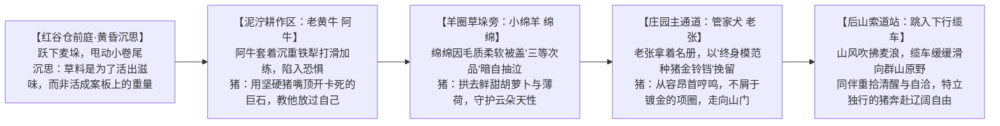

# 《特立独行的猪》现代农庄寓言全本剧本
## 舞台：新星模范生态农庄 (The Modern Farm Allegory)
## 主人翁：一头真正特立独行的猪
## 主题：在规训中坚守本真，在从容中重拾力量

---

## 一、主人翁重塑——致敬王小波笔下那头真正的猪

> “除了这只猪，我还没见过谁敢于如此无视对生活的设置。这只猪活得自由自在，成了我生活中的一个榜样。”  
> —— 王小波《一只特立独行的猪》

### 1. 它是怎样一头猪？
- **回归地道纯正的动物本体**：
  它不是套着西装风衣的人形怪，**它是一头地地道道、活生生的猪**！
  体态健硕圆润，皮肤温润粉白，有着像山羊一样敏捷有力的四蹄、一对扑棱的大耳朵、一截灵动的小卷尾巴，以及一张拱起地来比铁铲还有劲的硬鼻梁。
- **独一无二的精神特质**：
  - 农庄里别的猪，一辈子都在泥水里哼哼唧唧，为了一槽添了添加剂的甜豆粕争得头破血流，任由农场主把它们催肥、给它们称重，按部就班地奔向既定的屠宰命运。
  - **唯有这只特立独行的猪**：
    - 它不争食，不媚俗，吃饱了便喜欢在微风中轻盈跃上高高的红谷仓屋顶，俯瞰无边无际的麦田，聆听群山里天鹅与孤雁的啼鸣；
    - 它嘴角常年斜叼着一根金黄的干麦穗，神情悠游自在、不慌不忙；
    - 它长着一双极其清澈而深邃的眼睛，能听懂牲口棚里每一只动物的叹息与心结。
- **它在寓言里的力量**：
  它不需要说人类的冗长口号，甚至不用人类的复杂词汇。它以一头猪最质朴、最天然、最具生命力的方式——**用有力的猪鼻子拱开石头、用湿润的鼻尖推过胡萝卜、用从容坚定的眼神与哼鸣**，照亮了身边这群被现代规训折磨得神魂俱疲的动物同伴。

---

## 二、5分钟现代农庄寓言动线：黄昏 17:30 的阳光大院

夕阳将整个现代化生态农庄染成了无边无际的暖金色。全庄的广播喇叭里正回荡着冷冰冰的高亢声音：“今日全区产能指标超额12%，争创全庄红旗农舍，请大家抓紧晚间黄金窗口加练加耕！”

特立独行的猪从干草垛旁站起身，甩了甩尾巴上的碎草屑，嘴里叼紧麦穗，迈着从容稳健的小碎步，准备穿过农庄大院，前往后山通往广袤大自然的**【古老木质索道小缆车】**。

---

## 三、具体剧本幕次与经典台词设计

### 【第一幕：谷仓的黄昏钟声】
- **情景**：夕阳斜穿过巨大的红木谷仓，空气中弥漫着发酵草料与干木头的醇厚香气。高音喇叭正在重复播送：“争创五星生态示范牲畜，服从统一营养配比调控！”
- **猪的动作**：特立独行的猪从干净的麦垛顶上轻盈跃下，抖了抖耳朵，低头在木桶边喝了口清甜的井水，嘴里重新挑起一根崭新的干麦穗。
- **心声沉思**：
  > “农场主管总对猪圈里的同类说：只要按时把饲料吃光，长得越沉，就越是一头有价值的体面猪。  
  > 可是从来没有一头猪停下来想过：被称重出来的价值，究竟是对谁的价值？  
  > 我今天在东边引水渠帮大家拱开的淤泥已经通畅，该做的事已经做完。太阳落山了，属于我的群山在唤我前行。”

---

### 【第二幕：老黄牛阿牛的深渊 (耕作执念)】
- **情景**：在沉重泥泞的黑土垄上，老黄牛阿牛被沉重的铁木大犁套得皮开肉绽，四个牛蹄不住地打滑，嘴里吐着白沫喃喃自语：“还差两分地……必须翻完！隔壁马圈今天跑了五趟长途，我翻不够三亩，评优肯定垫底，扣了精饲料我怎么活啊……”
- **交互**：特立独行的猪走上前，低头用坚硬强健的猪鼻梁，找准角度猛地一拱！咔嚓一声，一块死死卡在犁刀铁齿里的顽固花岗岩被硬生生顶飞了出来！紧接着，猪用下巴轻轻挑开了阿牛脖子上勒得发紫的硬木套销。
- **对话与启发**：
  - **阿牛**（惊魂未定，牛眼通红）：“阿猪……别碰我的套扣！我还能耕！我今天要是停下来，明天管家就会把更重的铁链挂在我脖子上……”
  - **特立独行的猪**（昂起头，用清澈平静的眼睛看着老黄牛，嘴里麦穗微晃）：
    > “阿牛，低头看看你脚下。那块石头卡在犁刀里两个时辰了，你是在跟土地较劲，还是在跟心里的恐惧较劲？  
    > 这副犁是农庄为了收成给你打造的，但四条蹄子和这条命是你自己的。  
    > 大地到了冬天都要封冻休养，连黑土都懂得不勉强自己，你一头活生生的牛，何苦把自己当成不知疼痛的铁机器？  
    > 卸了吧。洗洗蹄子，草料吃多吃少饿不死健壮的牛。今晚天边的晚霞红得像火，去小溪边喝口甜水，看看天。”
  - **阿牛的转变**：老黄牛看着滚落一边的卡石，沉重的牛头缓缓垂在泥地里，长长地呼出一道白汽，眼中的血丝和惊恐慢慢褪去，多年紧绷的脊梁第一次松弛了下来。

---

### 【第三幕：羊圈角落的暗自抽泣 (小绵羊绵绵)】
- **情景**：在羊圈最偏僻的矮木栅栏旁，刚被剃得光溜溜的小绵羊绵绵蜷缩在草垛阴影里，抽抽搭搭地掉眼泪。栅栏上插着一块木牌，上面用刺眼的红墨水盖着——“三等次品羊毛：过分柔软纤细，缺乏工业纺织硬度，不予评优”。
- **交互**：特立独行的猪走过去，顺脚踢正了被踢翻的小木槽，从鼻尖前推过去一颗从田垄里刨出来的水嫩小野胡萝卜，还有两片带露水的绿薄荷叶。
- **对话与守护**：
  - **绵绵**（抽泣，抱住冻得发抖的自己）：“阿猪哥……他们说我的毛又细又软，织不出笔挺厚重的工作制服，说我是整个农庄里最笨、最没用的小羊……我是不是生来就是个错误？”
  - **特立独行的猪**（靠在木栅栏上，大耳朵在晚风中轻轻扑棱，神情无比温厚）：
    > “小羊，你知道为什么他们嫌你的毛太细软吗？  
    > 因为工厂的织布机只要流水线上硬邦邦的粗毛毡，他们不懂得，天上的云朵本来就是柔软的。  
    > 你的毛柔软，是因为你天性细腻温存，对每一缕拂过原野的春风都怀着善意。那绝不是缺陷，那是造物主留给你的最特立独行的光芒。  
    > 别拿纺织厂的规矩来称量自己的灵魂。快把胡萝卜吃了，天凉了早点缩进暖草堆，你的春天，比这间逼仄的棚圈宽广得多。”
  - **绵绵的转变**：绵绵抹掉眼泪，咬了一口脆生生甜滋滋的小胡萝卜，两颗乌黑的眼珠亮了起来，在金色的晚霞中第一次骄傲地仰起了小羊脸。

---

### 【第四幕：大院主干道上的挽留 (管家犬老张)】
- **情景**：穿过农庄中央大理石庭院，戴着铮亮铜铃铛、脖子上挂着哨子、夹着厚厚考核档案的管家牧羊犬老张迎面小跑过来。见这只猪嘴里叼着麦穗昂首阔步往后山走，老张急忙横在石板路当中。
- **对话与大智慧**：
  - **老张**（居高临下，摇晃着胸前的铜铃，语气诱惑又威严）：“阿猪！站住！这太阳还没全落山呢，你往后山晃悠什么？  
    庄园主今天批条子了：只要你肯签协议，留在前庭做‘五星级生态种猪展示标兵’，以后每天不仅有精磨豆饼，下个月司庆还破格发给你一枚纯金铃铛项圈！这可是全农庄几百头牲口打断腿都求不来的编制和体面啊！”
  - **特立独行的猪**（停下脚步，嘴里的麦穗在风中一翘一翘，嘴角扬起一抹看透一切的从容笑意）：
    > “张管家，东边那三条引水渠的石缝，我今天晌午就已经全拱通了，开春引水浇地绝不会误工，我没占农庄半分便宜，也没欠庄园一口粮食。  
    > 至于你说的纯金铃铛和模范槽位……那些镶金的项圈，还是留给愿意在木槽前摇尾巴排队的人吧。  
    > 槽里的豆饼再香，也是在栅栏里数着日子等上案板；后山野林子里的酸果子虽然有些涩嘴，但每一口嚼碎的都是山风的自由。  
    > 你的铜铃摇得很响，但外面的山风更大。张管家，看门辛苦，天黑了，早些歇着吧。”
  - **老张的反应**：老张呆呆立在石板路上，铜铃的声音戛然而止。它看着面前这只神色自若、毫无畏惧的猪，张口结舌，以往那些威逼利诱的管理话术像打在了虚空之中。老张苦涩地叹了口气，收起了名册，向路边侧了侧身子：“……你这头猪啊，打生下来谁也管不住你。走吧，后山山道险，自己多当心。”

---

### 【第五幕：后山木缆车与自由原野 (终章演出)】
- **情景**：
  - 猪迈着轻盈稳健的小碎步，来到了农庄最高处的后山索道崖口。
  - 这里停靠着一架饱经风雨的古老木质索道吊厢。崖下，是浩瀚无际的金黄原野、蜿蜒如银带的小溪和落日染红的无边森林。
  - 背景音乐中，悠扬空灵的木吉他与风笛随晚风响起，充满了辽阔治愈的生命力。
- **动作与交互**：
  - 猪伸出前蹄与长长的坚韧拱嘴，将吊厢旁的木质启动插销用力一顶。
  - 齿轮发出一阵欢快的转动声，木门吱呀一声滑开，缆绳在落日余晖中平稳共振。
- **回望**：
  - 猪站在吊厢门口，转过身，向身后的阳光农庄最后看了一眼——
  - 远处的溪水边，老黄牛阿牛正悠闲地甩着尾巴饮水；羊舍旁，小绵羊绵绵在草垛顶上欢快地蹦跳向这里目送；管家犬老张也熄灭了刺眼的巡查大灯。农庄的沉重与焦虑，在这一刻被落日金辉彻底融化。
- **踏入缆车**：
  - 猪纵身一跃跳上木质吊厢，前蹄搭在木栏上，麦穗在风中肆意飞扬，黑色的小眼睛里映照着整个天地的晚霞。
  - 缆车沿着古老的索道缓缓下行，载着这只真正特立独行的猪，滑向属于它的广袤群山与辽阔生活。
- **终屏金句**：
  > **“世间只有一种真正的特立独行，那就是认清生活的规训后，依然选择从容而体面地活出自己。”**  
  > **“不随波逐流，亦不愤世嫉俗；守住内心的火，走属于自己的路。”**  
  > **“愿每一颗不肯被驯服的灵魂，都能在阳光下的广阔田野里自由漫步。”**
