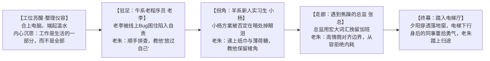

# 《特立独行的猪》MVP Demo 故事线重构案
## 主题：在规训中坚守本真，在从容中重拾力量

---

## 一、核心创作主旨与哲学转向

### 1. 从“负面情绪发泄”转向“正向力量与处事智慧”
- **否定纯粹的反讽与破坏**：原先“踢翻咖啡、咬断网线、仓皇逃跑”的设计，本质上只是被动受害者的宣泄，无法给玩家带来真正的启发与长久的力量。
- **肯定成年人的成熟自洽与社会意义**：
  现实职场确实存在内耗、黑话、焦虑与无意义的规训，但主人公不需要变成破坏狂，也不需要变得愤世嫉俗。
  **“负面的描写是真实的土壤，但它必须长出坚韧、清醒、体面且温暖的花朵。”**
- **终极玩家共鸣——“这简直就是我！”**：
  我们希望每一位每天在早高峰挤地铁、在会议室里感到疲倦、面对房贷与KPI偶尔迷茫的当代人，在操作“老朱”的短短5分钟里，能看到一个**“理想中的自己”**——既没有被环境同化成冷血盲从的工具，也没有被现实击垮，而是在认清生活真相后，依旧保有幽默、温情、情商与坚定的内心秩序。

---

## 二、角色设定重构——《红猪》式的主人公“老朱 (Mr. Pig)”

> “不能飞的猪，就只是一只普通的猪罢了。” —— 宫崎骏《红猪》

- **视觉与奇幻设定**：
  这是一个带着轻度魔幻现实主义的职场世界。大家并不大惊小怪他长得像一只猪，他是公司里一位资深的高级业务架构师，大家都尊称他为**“老朱”**或**“朱老师”**。
  - **外形**：体态微胖圆润、面色红润，身穿剪裁合身的卡其色经典风衣，浅蓝衬衫领口微微解开一颗扣子，戴着一副低调的复古墨镜。
  - **气质**：步伐沉稳，举手投足有一种见过大风大浪后的松弛感。哪怕周围的人再兵荒马乱，他站在那里，就像定海神针。
  - **寓意**：正如王小波笔下的特立独行，也如红猪波鲁克，他不肯被体制“骟掉”自己的独立灵魂与生活审美，岁月给他的外表盖上了“猪”的烙印，但他活得比任何人都更像一个真正的人。

---

## 三、Demo 5分钟叙事动线设计：周五傍晚 19:15 的办公室

整个第一幕的故事发生在一间被夕阳染成暖金色的现代化大厂办公室中。从老朱站起身准备下班，到他最终迈入下行电梯，耗时约 5 分钟，包含三次深度的微型职场对话与内心沉思。

---

## 四、具体剧情幕次与精妙对话设计 (极乐迪斯科级台词)

### 【第一幕：黄昏的定音】
- **情景**：时钟指向 19:15。工位区键盘声嘈杂，全员都陷在“谁也不敢第一个走”的面子牢笼里。
- **老朱的动作**：玩家点击地面，老朱从容站起身，抚平风衣的褶皱，合上轻薄笔记本。
- **物品交互（桌上的咖啡杯）**：轻轻拿起桌角微凉的拿铁，喝下最后一口，扶正歪斜的笔筒。
- **内心独白（老朱的沉思）**：
  > “年轻人总觉得，多在工位上耗上两个小时，就能换来安全感。  
  > 但安全感从来不是靠出卖健康和讨好流程换来的。  
  > 尊严是自己给的。今天的工作已经交付了应有的质量，现在，属于生活的钟声敲响了。”

---

### 【第二幕：老李的死循环 (牛系老程序员)】
- **情景**：走过中央工位通道，老李（一位头发稀疏、眼圈乌黑的老工程师）正死死盯着两块发红报错的显示器，双手抓着头发，喃喃自语：“不可能啊……明明本地通过的……今晚要是上不了线，绩效又要背C了……”
- **交互**：老朱走上前，拍了拍老李紧绷的肩膀。
- **对话分支与处事智慧**：
  - **老李**（焦虑、发抖）：“朱哥，你看这个并发冲突，我已经看了四个小时了，我觉得我可能真的老了，跟不上现在的框架了……”
  - **老朱**（从容一笑，弯下腰看了眼屏幕）：“老李，你把缓存层的重试机制关了试试。”
  - **老李**（敲键盘测试，绿灯瞬间亮起）：“……过了？！天哪，就这么一行配置？！”
  - **老朱**（递给他一杯温水，眼神温和）：
    > “老李，你不是跟不上框架，你是太累了，眼睛被焦虑蒙住了。  
    > 机器跑久了都知道要降频散热，人连机器都不如吗？  
    > 世界上没有一个Bug重要到需要用你的心肌梗死来换。你女儿不是一直想让你去接她放学吗？关机吧，周一太阳照常升起。”
  - **老李的转变**：老李愣了几秒，长长舒了一口气，眼角的皱纹舒展开来，郑重地开始保存文件关机。

---

### 【第三幕：暗角里的眼泪 (羊系实习生小杨)】
- **情景**：在通往茶水间的绿植隔断旁，新来的实习生小杨（卷毛、戴着工牌、年轻而脆弱）正靠在墙角，用衣袖悄悄擦眼泪。脚边散落着被领导批注得一片猩红的PPT打印稿。
- **交互**：老朱走过去，顺脚踢正了被小杨碰倒的垃圾桶，递过去一包纸巾和一颗清爽的薄荷糖。
- **对话与心性点拨**：
  - **小杨**（抽泣、自责）：“朱老师……张总说我的方案‘没有商业心智’，说我‘缺乏底层认知’……我是不是真的很笨，根本不适合留在这个行业？”
  - **老朱**（靠在墙边，双手插在风衣口袋里，淡然吐出一口气）：
    > “小杨，你知道为什么他们总喜欢用这些你听不懂的词吗？  
    > 因为当一个人无法在事实本身给出洞见时，就只能用庞大晦涩的辞藻来装点自己的权威。  
    > 你的方案我看过，逻辑很真诚，切中了用户的真实痛点。唯一的缺点，就是没能迎合他炫耀PPT的虚荣心。  
    > 别拿别人的尺子来量自己的长短。保持你这颗懂得体察别人的敏感的心，那是你身上最珍贵、最特立独行的地方，千万别让这间屋子里的灰尘把它磨平了。”
  - **小杨的转变**：小杨接过薄荷糖，眼中的迷茫渐渐退去，露出释怀的微笑：“谢谢朱老师，我明白了。我回去把真实的调研数据留着，周一做第二手准备。”

---

### 【第四幕：走廊上的对齐 (面对焦虑的总监 张总)】
- **情景**：在走廊主干道上，拿着保温杯、眉头深锁的部门总监张总迎面走来。看到老朱手里拿着车钥匙准备离开，张总愣了一下，下意识想拦住。
- **对话与高情商边界感**：
  - **张总**（试探性施压）：“老朱啊，这就准备走了？今晚大客户的Q4规划还要拉通对齐一下，你看大家都在咬牙坚持，咱们核心骨干是不是也……”
  - **老朱**（停下脚步，眼神从容不卑不亢，微笑着直视总监）：
    > “张总，核心的框架和三条落地抓手，我下午四点半就已经推送到您的邮箱和看板里了，标红的部分是关键风险点，周一早会半小时就能拍板。  
    > 如果我现在留下来和大家一起熬到凌晨两点，除了消耗大家的意志力、在群里多发几条看似努力的日报之外，对方案质量没有任何实质提升。  
    > 一支疲惫不堪的军队是打不了胜仗的。您也是，早点回去休息吧，您这周的偏头痛药吃得比饭都多了。”
  - **张总的反应**：张总张了张嘴，原本准备好的大厂规训话术在老朱清晰专业的事实与真诚关怀面前完全失效，最终叹了一口气，苦笑着拍了拍老朱的胳膊：“行，老朱，还是你想得透彻。路上慢点。”

---

### 【第五幕：电梯厅的归途 (终局与升华)】
- **情景**：老朱穿过长廊，来到全景落地窗前的电梯厅。
- **视听演出**：
  - 傍晚金色的残阳透过落地窗打在水磨石地面上，浮尘在光柱中缓缓舞动。
  - 背景音乐从压抑的办公室杂音，转为温暖悠扬的爵士萨克斯与吉他独奏。
  - 老朱伸出手，按下电梯下行按钮。
  - 叮咚一声，银白色的电梯门徐徐展开。
- **回望**：
  - 老朱回过头，望向深邃的办公室——
  - 远处，老李已经背上了双肩包向同事挥手道别；小杨擦干净了桌子，桌上放着那颗闪亮的薄荷糖；紧绷的办公室空气里，仿佛被打开了一扇吹进新鲜晚风的窗户。
- **踏入电梯**：
  - 老朱踏入电梯轿厢，转过身，推了推鼻梁上的墨镜，嘴角挂着一抹从容淡定、洞悉世事的微笑。
  - 电梯门缓缓合拢，光影逐渐收窄。
- **终屏金句（沉淀于心）**：
  > **“世间只有一种特立独行，那就是认清生活的规训后，依然选择从容而体面地活出自己。”**  
  > **“不随波逐流，亦不愤世嫉俗；守住内心的火，照亮身边的路。”**  
  > **“周五愉快，致每一位了不起的你。”**
