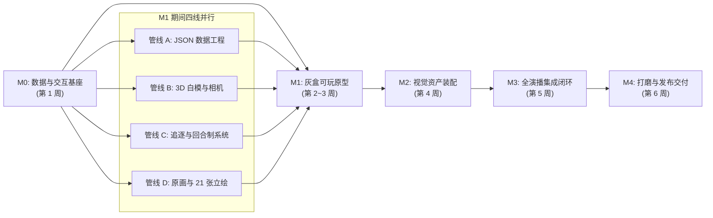

# 《一口猪在金牌农场》全流程研发推进主计划 (Production Master Plan)

> **版本**：v1.0.0 (生产定稿执行版)  
> **基准设计**：[`GDD_GAME_DESIGN.md`](file:///c:/Users/chenziyu/project/piggame/docs/GDD_GAME_DESIGN.md) · [`DIALOGUE_SCRIPT_AND_EVENT_MAPPING.md`](file:///c:/Users/chenziyu/project/piggame/docs/DIALOGUE_SCRIPT_AND_EVENT_MAPPING.md)  
> **引擎架构**：Godot 4.x (Compatibility 渲染器，支持 Web / PC 双端)  
> **核心原则**：数据驱动、灰盒玩法先行、模块化美术替换、多管线严格并行。

---

## 一、 全流程里程碑路线图

---

## 二、 详细阶段分解与执行任务

### Phase 0: 基础设施与数据锁死 (Milestone 0: Data & Architecture Baseline)
**周期**：1 周  
**目标**：完成数据层解耦与通用交互组件封装，消除后续开发的一切阻塞。

* [ ] **Task 0.1 数据工程落地**
  * 将 [`docs/DIALOGUE_SCRIPT_AND_EVENT_MAPPING.md`](file:///c:/Users/chenziyu/project/piggame/docs/DIALOGUE_SCRIPT_AND_EVENT_MAPPING.md) 的节点数据转化为标准 JSON 文件：`res://data/dialogues/pig_story_dialogues.json`；
  * 建立轻量级数据验证脚本，确保每个 `next_node_id`、`event_trigger` 均有对应定义。
* [ ] **Task 0.2 对话管理器重构升级**
  * 改造 [`scripts/core/dialogue_manager.gd`](file:///c:/Users/chenziyu/project/piggame/scripts/core/dialogue_manager.gd)：
    * 移除硬编码字典，改为启动时异步载入 JSON；
    * 增加支持多选项分支与动态退出（离开/重访逻辑）；
    * 接入立绘加载器（根据 `speaker_id` + `expression` 动态索取贴图）。
* [ ] **Task 0.3 通用场景交互组件 (`InteractionArea3D`)**
  * 封装 `scenes/components/interaction_area_3d.tscn`：
    * 包含 `CollisionShape3D` 与头顶交互提示图标（“按 E / 屏幕点击调查”）；
    * 挂载 `interaction_id`，统一向 `DialogueManager` 发起对话或环境调查请求。

---

### Phase 1: 四线并行冲刺 (Milestone 1: Greybox Prototype & Art Sprint)
**周期**：2 周  
**目标**：在没有任何精细 3D 模型的前提下，用白模完整跑通“山顶 ➔ 大院 ➔ 追逐 ➔ 铁门回合制 ➔ 索道”全流程；美术线同步交付全套立绘。

#### 1. 管线 A（关卡白模与机位）：
* [ ] **Task 1.A.1 全动线 3D 灰盒地形搭建 (`farm_level_greybox.tscn`)**：
  * 用 Godot `CSGBox3D` 搭建空间结构：
    1. 山顶悬崖残墙猪圈（高处起点）；
    2. 黑土垄耕地区（老牛与断犁）；
    3. 阴暗木棚区（小羊与残次牌）；
    4. 赛道分岔路口（**必经之路金牌纪录木牌**）；
    5. 泥地跑道椭圆圈（烈马与围栏）；
    6. 中央开阔追逐大院（草垛与木箱掩体）；
    7. 后山铁闸大门；
    8. 悬崖古索道站台。
* [ ] **Task 1.A.2 斜 45 度相机与遮挡测试**：
  * 调试 [`isometric_camera.gd`](file:///c:/Users/chenziyu/project/piggame/scripts/core/isometric_camera.gd)，确保主角猪在各拐角奔跑时不被前景建筑遮挡；
  * 锁定场景度量衡（Metrics）：主角猪长 1.2m，主路宽 4m，掩体高 1.5m，大铁门高 4m。

#### 2. 管线 B（核心玩法与战斗机制）：
* [ ] **Task 1.B.1 空地敏捷追逐战核心循环**：
  * 护院犬群 NavMesh 导航追踪 AI（巡逻、察觉、加速扑咬）；
  * 三大技能程序实装：
    * `SKILL_HORSE_DASH`（疾风之步）：按下 Shift 获得 2 秒高机动冲刺；
    * `SKILL_SHEEP_INSIGHT`（洞察之眸）：识破假身幻影，高亮真身与最佳突围路线；
    * `SKILL_OX_TENACITY`（坚忍之骨）：被扑倒时触发 0.8 秒 QTE 强行挣脱。
* [ ] **Task 1.B.2 铁闸门人猪意志对决（回合制 UI 演播）**：
  * 制作回合制 UI 弹窗（农场主立绘与信念值槽、主角猪反击选项按钮）；
  * 接入三回合对决流程与破门动画序列触发器。

#### 3. 管线 C & D（原画设定与 2D 立绘绘制）：
* [ ] **Task 1.CD.1 角色概念卡定稿**：
  * 锁定 6 位角色美术基底：047耳标白猪、老岩羊、断角老牛、蓬松小羊、中年黑驹追风、胶围裙农场主。
* [ ] **Task 1.CD.2 21 张立绘与表情差分交付**：
  * 依据规范输出 `1024x1024` 透明底 PNG，入库至 `res://assets/art/portraits/`。
* [ ] **Task 1.CD.3 6 件核心道具/环境线索图标输出**：
  * 生锈铜插销、破木门栓、35秒新木牌、崩口犁、残次评审单、高压电击棍。

> **M1 阶段验收标准**：
> 玩家操控胶囊体白猪，从山顶走到索道，与方块 NPC 对话能弹出正式立绘并触发离开/重访；在必经之路调查纪录牌；能顺利完成追逐躲避与回合制破门。

---

### Phase 2: 3D 资产建模与白模替换 (Milestone 2: Asset Staging)
**周期**：1 周  
**目标**：依据经过实机验证的白模尺寸，制作/采购并替换正式 3D 场景模型与材质。

* [ ] **Task 2.1 白模导出与尺寸参考网格**：
  * 将验证完毕的 Godot 灰盒场景导出为 `.glb`，导入 Blender 作为绝对尺寸参考。
* [ ] **Task 2.2 模块化农场资产上架**：
  * 制作并替换模块化资产：木质栅栏、朽烂围墙、草垛、泥泞耕地贴图、水渠模型、后山重型铁闸门；
  * 严格遵循技术规范：静态障碍物命名添加 `-col`，可冲撞轻量物件添加 `-rigid`。
* [ ] **Task 2.3 关键剧情模型与道具绑定**：
  * 制作主角猪 3D 低模（带耳标、印戳，嘴部预留挂载节点 `Marker3D` 用于叼起铜插销）；
  * 制作牛、羊、马的 3D 静态或简单动画模型（低头饮水、卧倒晒毛、探头嚼草）。
* [ ] **Task 2.4 光照与环境氛围烘焙**：
  * 配置 Godot `WorldEnvironment`：山顶晨曦体积雾、农场正午昏黄沙尘、索道黄昏金色光晕。

---

### Phase 3: 全演播集成与双结局闭环 (Milestone 3: Narrative Staging)
**周期**：1 周  
**目标**：将剧情演出、相机运镜、音效与 NPC 行为严丝合缝地串联。

* [ ] **Task 3.1 “回话而后行动” 3D 演出串联**：
  * 老黄牛：对白触发 `EV_OX_DRINK_WATER` ➔ 播放木轭脱落物理刚体 ➔ 行走至水渠低头饮水循环；
  * 小绵羊：对白触发 `EV_SHEEP_SUNBATHE` ➔ 播放抖毛粒子特效 ➔ 移动至阳光光束下蜷卧；
  * 烈马追风：对白触发 `EV_HORSE_GRAZE_WILD` ➔ 赛道制动扬泥 ➔ 踱步至栏边探头嚼草。
* [ ] **Task 3.2 终局决战与索道终章运镜**：
  * 农场主战败后跌坐在地、拍裤腿啐唾沫的闲置动画；
  * 铜插销入槽动画、索道齿轮咬合火花特效；
  * 木吊厢滑出绝壁向麦浪飞驰的运镜序列（Camera Track）。
* [ ] **Task 3.3 成就系统与双结局流转**：
  * 结局一【安稳的肉馅】：选择蓝色之路 ➔ 走回食槽低头进食 ➔ 画面淡出与运牲车低鸣 ➔ 弹出成就【温热的泥浆】；
  * 结局二【旷野归途】：乘索道破风飞驰 ➔ 弹出成就【特立独行的先驱】 ➔ 终屏金句字幅滚动。
* [ ] **Task 3.4 音效 (SFX) 与背景音乐 (BGM) 铺设**：
  * 猪蹄小跑声、撞门木裂声、铜插销金属撞击声、警报呼啸声、泉水咕咚声、索道风鸣声。

---

### Phase 4: 打磨、性能调优与交付 (Milestone 4: Polish & Release)
**周期**：1 周  
**目标**：达到商业独立游戏可发布标准，流畅适配 PC 与 Web 端。

* [ ] **Task 4.1 性能预算达标测试**：
  * 依据 [`QUNHE_AHOLO_TECH_SPECS.md`](file:///c:/Users/chenziyu/project/piggame/docs/QUNHE_AHOLO_TECH_SPECS.md)，单屏可视多边形严格控制在 50,000 ~ 80,000 面以内；
  * 纹理贴图压缩优化（WebP/通道合并），确保 WebAssembly/WebGL 环境稳定 60fps。
* [ ] **Task 4.2 交互与边缘测试走查**：
  * 完整走查“调查所有环境物件 ➔ 与动物对话离开 ➔ 重访对话 ➔ 不拿技能硬跑追逐战 ➔ 通关”全路径；
  * 走查“跳过所有支线直接冲撞铁门”的容错性。

---

## 三、 风险控制与应对策略

| 风险点 | 严重程度 | 应对与缓冲策略 |
| :--- | :---: | :--- |
| **美术立绘产能延期** | 中 | 核心系统完全采用占位立绘（带表情色块文字），立绘仅需替换同名 PNG 即可生效，不阻塞程序和玩法测试。 |
| **追逐战手感过难或过简单** | 高 | 在白模阶段（Phase 1）将犬群移动速度、扑咬判定半径、技能冷却时间抽离为独立导出变量 (`@export`)，随时调参。 |
| **3D 建筑阻挡俯视角视线** | 高 | **严格执行“白模跑通前不建高模”**；在着色器层预备一套“相机与主角之间物体半透明化 (Dither Transparency)”通用 Shader 作为兜底。 |
| **Web 端加载过大** | 中 | 模型与材质严格按 512/1024 尺寸烘焙；音效采用 OGG 高压缩格式。 |

