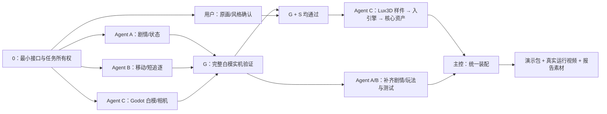

# 《一口猪在金牌农场》24 小时比赛 Demo 并行执行计划

> **版本**：v1.2.0 · 一人 + AI Agents 执行版
>
> **更新日期**：2026-11-01（Asia/Shanghai）
>
> **现状基线**：代码提交 `6297416`；延续上一轮静态审查，未将计划任务标记为已实现。
>
> **唯一近期目标**：24 小时内拿到能实际运行、能完整演示、能展示 Aholo Lux3D 核心资产的游戏 Demo。
>
> **分工已确认**：用户负责原画与美术风格把关；AI Agents 负责代码、Godot 白模、集成测试及 AHOLO 辅助 3D 制作。没有额外人类开发/美术/QA 团队。
>
> **制作硬依赖**：正式 3D 制作必须同时等待“可玩白模验证通过”和“用户确认原画/美术风格”；两项准备可以并行。
>
> **状态**：本次修改的是执行计划，未启动下述实现任务。上一版六周排期、商业发布和多人类团队假设全部撤销。

## 一、交付目标与比赛约束

### 1.1 24 小时的最小成果

做出一段建议 **5–8 分钟**、能够从头走到结局的农场突围 Demo：

**序幕红蓝选择 → 红线取得插销 → 农场探索/一个完整伙伴交互 → 无技能可过的短追逐 → 三回合对白对决 → 破门 → 玩家走到索道并启动 → 结局与重开。**

伙伴交互可以跳过；追逐、破门和索道条件不能跳过。蓝色结局复用现有短对白与结局面板。三个伙伴的原有对白尽量保留，但今天不以完整重写全部分支、39 节点 JSON 化、三技能全部上线为交付前提。

**可行性判断**：围绕现有原型做上述闭环，并在核心场景接入经过验证的 Lux3D 资产，可以作为 24 小时目标；原 v1.1 的全部功能与质量流程不能压缩成一天。主要不确定项是 Godot 实际工具链、用户风格确认时间、AHOLO 生成/导出与资产返修耗时。

### 1.2 官方要求与本次内部时限

来源：用户提供的官网 `https://www.aholo3d.cn/hackathon?utm_source=workshop`。2026-11-01 核对官网公开页面及其加载的官方内容文件。

- 官网截止为 **2026 年 11 月 19 日 19:00，北京时间**；用户要求的 **24 小时演示版是更早的内部交付目标**，不能借官方日期延后。
- 支持单人参赛；个人也需建立参赛团队。AI Agents 是制作工具，不作为虚构的人类队员登记。
- 作品必须使用 **Aholo Lux3D**，使其参与核心 3D 内容或关键创作流程；Aholo API、LuxReal 等按需使用，不强制做运行时 API 集成。
- 必交包括项目报告书、完整 Demo（链接或视频）；视频必须含真实运行画面。页面标题与说明对链接/视频的措辞略有差异，本次准备本地可运行包及真实运行视频，最终在线提交时按表单再核对。
- 源码和社交媒体发布链接在页面标为加分项；今天整理本地源码与报告素材，不自动发帖、报名或提交。

**内部资产最低目标**：至少一件已确认且实际用于必经流程的 Lux3D 核心资产，优先索道，其次铁门；其余模型数量按生成结果和剩余时间控制。

**制作上的直接取舍**：Lux3D 不能只做一个角落里的装饰或只出现在报告中。优先让它提供索道站/吊厢、铁门或主角外观等玩家必然看到的核心资产；保留输入参考、生成结果、修改和入引擎对比，证明实际使用过程。这里的资产数量是内部制作目标，不是对比赛最低数量的推断。

### 1.3 平台和时间口径

- **主交付平台先定 Windows 本地包**，沿用 Godot Compatibility；便于当前机器直接演示和录制。Web 作为有余力时的附加交付，不能成为一天内的双平台硬负担。
- 如用户实际演示设备要求浏览器，启动时将 Web 升为唯一主平台，并在第一轮验证导出；不等收尾再发现平台不符。
- `T0` 以用户提出“一天内出演示版本”要求的时刻为基准；开工记录绝对截止时间和实际剩余预算（Asia/Shanghai）。规划沟通、失败、重试和等待均消耗同一预算，不能从代码开工时重新计算一天。下文为完整 24 小时参考窗口，已消耗时间从前段扣除。
- **T+16 小时停止加功能，T+20 小时冻结演示构建，最后 4 小时留给修复、打包、录屏和缓冲。** 未达到关键门槛时立即缩范围，不默认为可以顺延。

## 二、今天必须做什么，什么可以后移

| 优先级 | 内容 | 处理方式 |
| :--- | :--- | :--- |
| P0：完整闭环 | 红蓝选择、插销、短追逐、三回合对白、破门、实际索道交互、结局/重开 | 必须能正常操作完成，不能靠隐藏调试跳转录制 |
| P0：可操作 | 键盘移动/E 交互、相机、碰撞/边界、对话输入锁、被捕重试 | 优先把一种操作方式做好；保留可用的点击移动，复杂点击寻路不阻塞主交付 |
| P0：一段代表性伙伴交互 | 建议老牛：初遇→离开/重访→回话→占位行动→完成态 | 用于证明叙事/事件机制；牛的挣脱技能如未完成则不显示已获得技能的错误承诺 |
| P0：核心资产展示 | 用户确认的风格 + Lux3D 生成并入场景的核心资产 | 首选索道站/吊厢与铁门；猪外观视生成可用性追加；其余使用统一低成本视觉 |
| P0：演示材料 | 主平台包、操作说明、真实运行视频、过程截图/资产记录、简短报告草稿 | 从生成/集成时持续留证据，收尾只编排，不回头补造过程 |
| P1：体验增强 | 羊/马完整离开重访、三技能、六种调查、完整八区域细化、更多音效 | 只在 P0 已能通关且 T+16 前还有余量时加入；按模块独立合入 |
| P2：本日不做 | 全量 JSON 重构、21 张正式立绘、持久化存档/坏档迁移、多语言、多平台全面适配、复杂绑定动画、群体战术、在线叙事/生成 API | 延后；保留接口，不为潜在扩展搭框架 |

当天保留 **内存检查点、失败重试与一键重开**，不把持久化存档作为必要项。只显示已实现的操作和技能；未完成的技能承诺、占位按钮和旧题材文案从演示入口隐藏或修正。

设计内容仍参考 [GDD](GDD_GAME_DESIGN.md)、[对话台本](DIALOGUE_SCRIPT_AND_EVENT_MAPPING.md) 与 [故事全本](PIG_STORY_LINE_FULL.md)。本日范围是其中一个可运行子集，不把未完成项从长期设计中删除。旧 [AHOLO 技术草案](QUNHE_AHOLO_TECH_SPECS.md) 中的办公室与在线叙事设定不再适用；**AHOLO 制作核心 3D 的路线则是本次比赛的明确要求，必须保留。**

## 三、并行判断：现在开工的三条线与两道门槛

| 工作 | 能否现在并行 | 依赖与限制 |
| :--- | :--- | :--- |
| 剧情状态/对话修复 | 能 | 主控先给稳定事件/交互 ID；A 用明确的测试替身验证，不等正式场景或立绘 |
| 玩家控制/单犬追逐 | 能 | B 在独立测试场地实现，不等全关卡完成；零技能可通关是基础 |
| 白模地形/相机/尺寸 | 能 | C 使用几何体和标记搭动线，按接口留出生点、NPC、门、追逐出口、索道点 |
| 原画与风格确认 | 能，与上述三条同时 | 用户决定；AI 可准备参考清单和资产规格，不能自行把“待确认”写成已确认 |
| AHOLO 账号/工具/额度检查与提示词模板 | 能 | 只检查可用性、准备输入，不提前生成正式模型或擅自购买额度 |
| 正式 3D 样件、生成、精修、批量资产 | **不能现在启动** | **G 白模实机通过 + S 用户风格确认**；两项缺任一项就继续代码/测试/素材准备 |
| 全局状态、输入表、根场景集成 | 由主控串行整合 | 不允许多个 worker 同时改根场景或全局配置 |
| 正式资产后续生成与代码完善 | 能 | 样件验证成功后，C 做资产，A/B 补体验和回归；主控按批次装配 |

**G 白模门槛（目标 T+4，最晚争取 T+6）**：在 Godot 实际运行，完成红线基础路线和蓝线结局；零技能追逐可过且能重试；对话期间停止移动；门/索道不会越级触发；相机与关键通道无遮挡/卡住。保留视频或日志。只做静态检查不能判通过。

**S 风格门槛（与白模同时，目标 T+4 前）**：用户明确确认一份标版本的风格包，至少包含猪外观、农场整体色调/材质方向、索道与铁门重点物件参考、简化程度。允许其他角色原画后补，但核心模型需要的风格/参考不能空缺。文字约定“低多边形”不代替用户确认。

“用户把关”不要求用户亲自绘制全部原画：用户可在自己的原画工作流中推进；需要 AI 出图时由主控组织候选，用户集中选择。当天在风格包、首件模型实机、最终短试玩三个节点集中反馈，不逐个脚本或模型打断用户，也不等 21 张立绘完成才开模。

**样件门槛（两门通过后）**：选一个核心静态模型经 Lux3D 生成/导出，由 AI 清理并导入 Godot，验证比例、朝向、材质、性能及视觉适配。成功后才扩批次。角色骨骼绑定不作为首件样件。

## 四、AI Agent 分工与文件所有权

采用 **1 个主控 + 最多 3 个并行 worker**。下面的角色是 AI 任务角色，不是招募人类岗位；不同阶段复用同一 worker，不把每个模块都开成一个常驻 agent。用户只做风格/体验的重要判断，不承担代码合并。

| 角色 | 独占修改范围（未存在的目录为拟建） | 第一批交付 | 门槛通过后的工作 |
| :--- | :--- | :--- | :--- |
| 主控 / 集成 | `project.godot`、现有 `scenes/levels/office_level_1.tscn` 与对应关卡脚本、角色选择 UI、计划/公共接口文档、导出配置；新增 `scripts/showdown/`、`scenes/showdown/` | 接口/输入表、根场景装配、现有对决对白与索道入口修复、首包 | 整合模型、固定三回合演出、构建/录制/最终检查 |
| Agent A / 叙事状态 | `scripts/core/game_manager.gd`、`scripts/core/dialogue_manager.gd`；新增 `scripts/dialogue/`、`scenes/ui/dialogue_panel.tscn`、`tests/state/` | 状态机、红蓝选择、插销/门禁、老牛链、输入模式通知、一次性结算 | 补伙伴/调查、完成 UI、复核 B 的状态交互；准备报告内容 |
| Agent B / 操作玩法 | `scripts/characters/pig_controller.gd`、`scenes/characters/pig.tscn`；新增 `scripts/chase/`、`scenes/chase/`、`scripts/components/interaction_area_3d.gd`、`scenes/components/interaction_area_3d.tscn`、`scenes/tests/chase_test.tscn`、`tests/chase/` | WASD/E、交互组件、输入锁、单犬短追逐、失败/成功/重试 | 修手感，按剩余时间加技能；复核 A 的事件与重开 |
| Agent C / 白模 → 3D 资产 | `scripts/core/isometric_camera.gd`；新增 `scenes/levels/greybox/`、`scripts/greybox/`、`assets/models/aholo/`、`assets/materials/`、`docs/ASSET_MANIFEST.md` | 几何白模、相机、碰撞、地图/尺寸/标记清单 | G+S 后转 Lux3D 生成、模型清理/材质、批次验收；不再继续扩地形 |
| 用户 / 风格把关 | 原画与风格选择的最终决定 | 确认 S 风格包 | 看首个模型实机截图，集中给反馈；末段快速体验与演示重点选择 |

### 4.1 防止并行返工的约定

1. **先花最多半小时冻结最小接口**：状态、交互 ID、信号、根节点类型、坐标/碰撞层、插销/门/索道挂载点。先写短接口清单与最小可加载替身，不先造大型架构。
2. **根场景只由主控保存**。Worker 交独立子场景；主控实例化并连接信号。暂保留 `office_level_1` 文件名，别在今天花时间整体改名和迁移。
3. 公共输入/Autoload/碰撞层只由主控改。C 不修改 B 的猪场景；正式猪外观由主控在 B 交接后装配到稳定 `VisualMesh` 下。
4. 当前共享工作区采用严格文件所有权；跨文件需求发接口请求，由文件 owner 修改。若改用 worktree，每个分支仍须遵守接口，主控验收后逐个整合，不让 worker 自行大范围合并。
5. **Godot 编辑器、Blender 会话、AHOLO 网页都是共享工具**，同一时刻一个操作者。C 做场景编辑/资产时，A/B 写独立脚本和测试；主控预约短时间做实机集成。不能靠三个 agent 同时控制同一 GUI 达到并行。
6. 每个工作包交付：改动文件、依赖接口、独立运行方式、实际测试结果/未测项、剩余问题。禁止用“代码已写”代替“运行通过”。所有 worker 明确知道其他 agent 也在工作，不覆盖/撤销他人改动。
7. 每 1–2 小时一个可集成小批次；主控每轮保留最近可运行版本。超预算模块停止扩展，不能让一个 worker 的大重构卡住全部人。

### 4.2 最小接口草案（实现前共同锁定）

| 接口 | 生产方 → 消费方 | 语义 |
| :--- | :--- | :--- |
| `request_interaction(interaction_id)` | B/C → 主控路由 → A | E/点击只请求，按状态选择对白或物件事件；不直接授奖励 |
| `set_control_mode(mode)` | 主控 → B | 探索/对话/追逐/演出/结算；切到对话取消旧移动并清速度 |
| `event_requested(event_id)` | A → 主控/场景处理器 | 事件统一登记；在对白确认后的正确时机执行 |
| `event_finished(event_id, success)` | 场景处理器 → A | 完成才提交状态/奖励；失败恢复该事件前快照，保留之前支线 |
| `chase_finished(success)` | B → 主控 | 成功才准入对决；失败弹重试，恢复内存检查点并清犬/计时器 |
| `reset_run()` | 主控 → A/B/场景 | 清本局状态和临时对象，恢复出发点与 UI |
| 场景标记 | C → 主控/B | `PlayerSpawn`、`OxPoint`、`ChaseStart`、`ChaseExit`、`Gate`、`CableCarMount` 等，具体名称在接口清单锁定 |

替身仅用于独立测试，必须标记“未接入”；生产入口不能默认为成功、自动开门或自动通关。对白继续复用现有字典；可加薄适配层统一字段/事件，不要求当天迁完 JSON。主线状态由 A 的 GameManager 唯一持有，关卡不能另存一套真值。

## 五、24 小时任务波次与超时处理

| 时间窗口 | 主控 | Agent A | Agent B | Agent C | 用户 / 验收产物 |
| :--- | :--- | :--- | :--- | :--- | :--- |
| T+0–0.5h | 确认 Godot/模板、主平台、接口、所有权；固定截止时刻 | 读接口与现有对白 | 读接口与移动脚本 | 检查白模环境、AHOLO 访问/额度/导出方式，仅准备 | 用户提供已有原画/风格方向；得到任务卡 |
| T+0.5–4h | 修入口/对决→索道编排，滚动整合并尽早导出 | 状态/门禁/选择/老牛/重开 | WASD/E/输入锁、单犬追逐/重试 | 完整路线几何白模、相机、碰撞/标记 | 用户同步盯原画，目标确认 S；得到首个可玩灰盒 |
| T+4–6h | 实机全流程，记录 G；用户看一份汇总演示 | 修状态/对白阻塞 | 修追逐/操作阻塞 | 修白模问题，整理冻结尺寸 | **G 与 S 均通过才放行正式 3D** |
| T+6–10h | 先装一个正式样件，复跑关键路线 | 修 UI/台词，保留现有其他伙伴对白 | 完善短追逐和重试，测试技能可行性 | Lux3D 核心样件→清理→Godot 验证；通过后下一件 | 用户集中看首件实机，确认风格符合；保留迭代证据 |
| T+10–14h | 批次装配索道/门等核心资产、灯光、基本声音 | 有余量再补羊/马重访与调查，整理报告 | 有余量再上技能，零技能回归不可省 | 核心资产完成，修材质/比例，交 manifest | 得到有 Lux3D 核心资产的完整可玩构建 |
| T+14–16h | 选择演示路线，删除坏按钮/调试入口 | 对白/状态回归 | 移动/追逐回归 | 停止扩资产，处理遮挡/碰撞/贴图问题 | 用户短试玩；**T+16 功能冻结** |
| T+16–20h | 主平台回归、打包、整理运行说明，录一段真实运行备份 | 修关键问题，出报告草稿 | 修关键问题，反复验证重试/重开 | 仅修已有模型、交过程对比图 | **T+20 构建冻结**；可运行包/视频备份已存在 |
| T+20–24h | 正式录屏、整理交付与备份；只修演示阻断 | 协助报告/说明校对 | 复核最终包 | 核对资产来源/证据 | 主平台包、真实视频、报告草稿、已知限制 |

这里是时间盒与停止条件，不是对单个 agent 速度的保证；以首轮实测进度调整工作量，不能把所有 P1 都塞入表格后假装能完成。

### 5.1 到点必须做的取舍

- **T+0.5 工具链不可用**：主控立即解决实际 Godot 执行路径/模板；A/B 可写独立代码，C 可整理白模尺寸，不能宣称 G 已通过。AHOLO 登录不可用时尽早提示用户完成登录，不等建模阶段才暴露。
- **T+4 白模不能通关**：停止旁支/技能/装饰，三 worker 只修各自阻塞；把关卡缩为同一场景内相连的猪圈、伙伴位、追逐区、门和索道，不强求八区域细化。
- **T+6 G 或 S 未通过**：模型仍不启动。继续修白模、整理已确认风格内容；向用户明确说明 24 小时“正式资产版”的风险，不能擅自替用户确认风格。可演示几何版仍继续推进。
- **T+10 正式样件不合格/生成排队**：优先减少模型数量和非关键几何复杂度，用静态索道/铁门等更易验证的核心资产；不用绑骨角色拖住整体。不以别家资产冒充 Lux3D。
- **T+14 无可用 Lux3D 核心资产**：保留可玩的几何版与真实制作记录，明确它尚未满足本计划的比赛资产目标；不要宣称比赛 Demo 已完成。其余打包/视频工作仍推进。
- **T+16 P0 未闭环**：回退未通过的 P1 模块，三技能、全量支线、额外立绘和 Web 优先移出；保留完整主线、门禁和重试。
- **T+20 后**：只处理启动失败、卡死、无法通关、核心模型丢失/错位等演示阻断；不再重构、升级引擎或生成大批新模型。

## 六、白模和原画如何交给 AHOLO 制作

### 6.1 开模前交接包

| 来源 | 必须明确的内容 | 谁确认 |
| :--- | :--- | :--- |
| 白模 | 资产尺寸包围盒、朝向/地面基准、玩家尺度、通路净宽、碰撞边界、挂载点、关键相机截图 | C 整理，主控实机验证 G |
| 原画/风格 | 已确认参考图/版本、轮廓与比例、主色、材质倾向、细节密度、需保留的识别元素 | 用户确认 S |
| 程序接口 | 视觉替换位置、交互根节点、是否移动、是否需拆分部件、动画方式、碰撞由谁提供 | 主控与 B/C 锁定 |
| AHOLO 输入 | 对象清单、参考图、尺寸/风格说明、生成批次、额度/队列可用性 | C 准备；按实际工具能力选网页或 API，不假定具备某种能力 |

在 G+S 前只做代码、几何白模、风格探索、输入模板和工具可用性检查，**不生成正式 3D 样件**。如果风格包没有索道/门参考，先补齐这些核心对象，不能直接“凭感觉建出来再让用户重做”。

### 6.2 核心资产优先级

1. **索道站/吊厢**：结局视觉中心。Lux3D 负责核心外观；运动由 Godot 的节点/Tween 实现，不依赖复杂机械模拟。
2. **铁门/锁具/门框**：追逐到终局的主线边界；外观可生成，碰撞/开门逻辑继续使用白模已验收结构。生成一整块时由 AI 适度拆分或采用简化开门表现。
3. **猪外观**：有合适生成结果则替换 `VisualMesh`，复用程序摇摆/位移，不把自动绑骨当作已具备能力；否则维持统一风格占位主角。
4. **农场模块/其他动物**：仅当核心路线已可演示且预算允许时做；木棚、围栏等可组合复用，不追求全场景独一件生成。

模型交付路径为 `assets/models/aholo/<asset_id>/`，保留原始导出和优化后的引擎版本。每件最多先做两轮候选；仍不合格时改用更简单的已确认方案或降低资产数量，不无限重抽。

**每件验收**：实际导出格式可被工具转换/导入；单位/朝向/材质透明正确；无关键破面；不封住通路；相机看得清；门/索道挂载正确；在实际演示设备上不造成明显停顿。第一件必须实机通过，后续才可以流水线生成与集成。

`ASSET_MANIFEST` 至少记录资产 ID、Lux3D 生成记录/截图、参考风格版本、白模版本、原始文件、AI 后处理、场景实例位置、验收状态。原画/白模/生成/入引擎四个阶段截图随做随存，用于项目报告；不虚构生成步骤或性能结果。

## 七、当天不可省的正确性与验收

### 7.1 状态正确性

- 进入对白不授技能、不标记开门；对白确认/动作完成后才提交。奖励与事件只结算一次，连点不重复推进。
- 索道必须检查红色选择、插销、追逐成功和三回合完成/开门状态；破门对白结束后返回探索，由真正的索道交互开始结局。
- 普通事件失败恢复事件开始前的内存快照；追逐失败恢复追逐前快照；重开清空本局状态。没有持久化存档时不显示“继续游戏”。
- 未实现技能不在 UI/对白中声称已可使用。若只做马冲刺，牛/羊能力可保留为后续设计，不设置假按钮。

### 7.2 最小验收矩阵

| 必测路径 | 通过标准 | 执行者 |
| :--- | :--- | :--- |
| 新游戏→蓝结局→重开 | 不残留上一局状态，结算后不能继续移动 | 主控，A 复核 |
| 新游戏→红线→零技能追逐→对决→索道→结局 | 正常操作完整完成，不用调试快捷键 | 主控实机 |
| 伙伴初遇→离开→重访→完成→再访 | 不提前奖励，不重复结算，对话能退出 | A 自测，B 交叉检查 |
| 未满足条件直奔门/索道 | 被正确阻止，不出现白给结局 | 主控，A 检查状态 |
| 被捕→重试至少 3 次 | 犬群/计时器/输入锁没有累计，之后仍可通关 | B 自测，主控实机 |
| 对话中点击外部/按移动/连续确认 | 不穿透移动、不串话、不跳过状态提交 | A/B |
| Lux3D 模型替换后的完整路线 | 资源齐全、无卡路、门和索道保持正常功能 | C 检查，主控实机 |
| 导出的主平台包冷启动 | 在新进程中正常启动/显示中文/走通主线，声音与操作可用 | 主控 |

不要求招募固定人数外部测试；用户的短试玩用于体验判断，AI 交叉检查和主控实机承担基础验收。Headless 检查只能证明部分代码/资源可加载，不能代替画面与操作验证。若实际引擎不可用，必须报告未验证，不能产出“已通过”的记录。

性能按实际演示设备、1280×720 记录，优先保证追逐/相机稳定；目标 60fps，必要时采用可接受的稳定 30fps 档并如实说明。暂不扩展最低配置矩阵、包体硬指标或多浏览器全面测试。Compatibility 避免真正体积雾等不支持的效果，优先简单光照和低成本材质 [G1]。

## 八、最终交付与复盘入口

- [ ] **可运行 Demo**：主平台包、简短操作说明、版本/提交号、已知限制；支持从头游玩和重开。
- [ ] **真实演示视频**：先录稳定完整运行作为备份，再剪重点；重点包含故事选择、追逐、破门、实际完成的 Lux3D 核心资产（优先索道，其次铁门）和结局。演示时长建议 1–3 分钟，但不是推断的官方时长规定。
- [ ] **报告草稿/素材包**：创意、玩法、用户与各 AI Agent 分工、Lux3D 作用、原画→白模→模型→实机对比、关键技术取舍、未完成项。
- [ ] **可追溯工程**：源码、模型与素材记录、最后可运行构建、资源路径和运行方法；秘密凭据不写进项目或报告。
- [ ] **交付判定**：主线能走通 + 主平台包可运行 + 用户风格已确认 + Lux3D 核心资产确实在场景中 + 视频来自真实运行。缺项就标明缺项，不用“几何版可玩”冒充比赛资产目标也已完成。

不在本次制作中自动报名、上传参赛作品或发社媒；这些是用户后续的提交动作，今天先把可审阅材料准备好。

## 九、第一轮可直接分派的任务卡

| 卡片 | Owner | 输入 | 输出 / 完成条件 | 状态 |
| :--- | :--- | :--- | :--- | :--- |
| C0 接口与工具链 | 主控 | 现有项目、24h 截止、主平台 | 可运行路径/模板、接口约定、输入表、3 worker 边界；最多 0.5h | 待执行 |
| A0 剧情与状态 | A | C0 接口、现有对白 | 选择/插销/门禁、老牛离开重访、重开、一次性事件；独立测试证据 | 待执行 |
| B0 操作与追逐 | B | C0 接口 | 键盘/E/输入锁、单犬追逐与重试；独立测试场景 | 待执行 |
| W0 几何白模 | C | C0 标记/尺寸约定 | 连通动线、碰撞、相机、挂载点及截图；不做正式模型 | 待执行 |
| S0 风格包 | 用户把关 | 已有/待选原画、核心资产清单 | 明确确认的风格版本与核心对象参考 | 待确认 |
| G0 白模实机验收 | 主控 | A0+B0+W0 整合 | 完整通关与重试证据；阻塞项修复 | 等待前置 |
| M0 Lux3D 样件 | C | **G0+S0 均通过** | 一个核心样件生成/清理/回导/实机验收 | 等待双门槛 |
| M1 核心资产批次 | C；主控装配 | M0 样件通过 | 已验收的索道/门等核心资产及记录 | 等待样件 |
| R0 演示交付 | 主控，A/B/C 支持 | 主线闭环+核心资产 | 冻结构建、主平台包、真实视频、报告草稿 | 等待整合 |

启动实现时，三 worker 的任务说明必须附上第四节所有权、禁止覆盖他人修改、接口版本与交付检查项。计划中的路径是责任边界，不表示文件已经创建；本次没有把任意开发任务标为完成。

## 附录 A：仍需处理的代码问题（2026-11-01 静态审查）

以下为静态代码与文档核对；行号对应上述基线。这里 P1/P2 是缺陷严重程度，与第二节的交付优先级不同。附录记录长期差距，今天的实现范围以第二节为准，不要求补齐全部功能。

| 级别 | 现状与证据 | 修订措施 |
| :---: | :--- | :--- |
| P1 | `scripts/levels/office_level_1.gd:60–75` 打开牛羊马对白即授技能，打开农场主对白即置 `power_cut` | 启动阶段建立事件完成后提交状态的机制；打开对白不等于事件完成 |
| P1 | `scripts/levels/office_level_1.gd:96–104` 索道没有插销、追逐和破门校验；`scripts/core/dialogue_manager.gd:314` 破门对白直接跳索道对白 | 补主线门禁；玩家实际到站后，经唯一交互入口触发终章 |
| P1 | `scripts/characters/pig_controller.gd:34–124` 只有点击直线移动，未消费已配置的 WASD/Shift/E 动作 | 玩家绕障、键盘控制、坡道和不可达处理是新增工作；白模阶段小场地先验证 |
| P1 | `scripts/levels/office_level_1.gd:106–148` 对话仅显隐面板，未与移动/演出互斥 | 启动阶段增加输入模式、停止旧移动、事件锁与恢复；防串话、连点重复结算 |
| P1 | `project.godot` 使用 Compatibility，原 Task 2.4 却要求体积雾 | Godot 4.3 体积雾不支持 Compatibility；改普通雾和少量雾片/假光束，按实际版本验证 [G1] |
| P2 | `scripts/core/game_manager.gd` 仍是办公室任务；农场进度在关卡局部变量中 | 今天统一状态、补新游戏/重试/重开；全量 JSON 迁移后移 |
| P2 | 对话管理器只提供字典查询，UI/推进在关卡脚本；旧 `content/next` 与台本 `text/next_node_id` 不同 | 当天采用现有字典的薄适配，修状态/事件；完整字段与 JSON 迁移列后续 |
| P2 | 仓库无已提交的对话 JSON、导航/追逐实现、测试脚本或 `export_presets.cfg`，`assets/` 暂无文件 | 首次主平台导出和验证前移至启动阶段；不得把计划能力记为已有能力 |
| P2 | 旧技术/角色文档仍描述办公室；选择界面还写猪不知危险、下个月被宰 | 明确文档优先级，清理与农场开篇“明早六点”冲突的文案 |
| P2 | 原计划六件道具与台本六种调查对象不一致，3D 清单遗漏农场主和护院犬 | 区分环境插图、剧情道具、角色/敌人模型，先样件再批量生产 |

**验证边界**：已审阅六个 GDScript、三个场景、项目配置和相关设计文档，并进行独立只读代码复核。台本明确列出 **39 个唯一对话/调查节点、12 个事件 ID**。未在 PATH 与已检查的常见安装目录找到 Godot 可执行文件，本次未运行引擎、导出或实测性能；运行验证列为启动阶段必做项。

## 附录 B：技术参考

- **[G1] Volumetric fog and fog volumes**：`https://docs.godotengine.org/en/4.3/tutorials/3d/volumetric_fog.html`。
- **[G2] Exporting for the Web**：`https://docs.godotengine.org/en/4.3/tutorials/export/exporting_for_web.html`。
- **[G3] Node type customization using name suffixes**：`https://docs.godotengine.org/en/4.3/tutorials/assets_pipeline/importing_3d_scenes/node_type_customization.html`。
- **[G4] Importing images**：`https://docs.godotengine.org/en/4.3/tutorials/assets_pipeline/importing_images.html`。
- **[G5] Exporting projects**：`https://docs.godotengine.org/en/4.3/tutorials/export/exporting_projects.html`。

v1.2 变更：按用户确认的一人 + AI Agents、24 小时比赛 Demo 重排；取消六周与商业发布假设；将原画/白模并行、G+S 双门槛后启动 Lux3D 制作写成硬依赖；增加文件所有权、工具会话互斥、累计小时波次、超时取舍和真实比赛材料要求。
