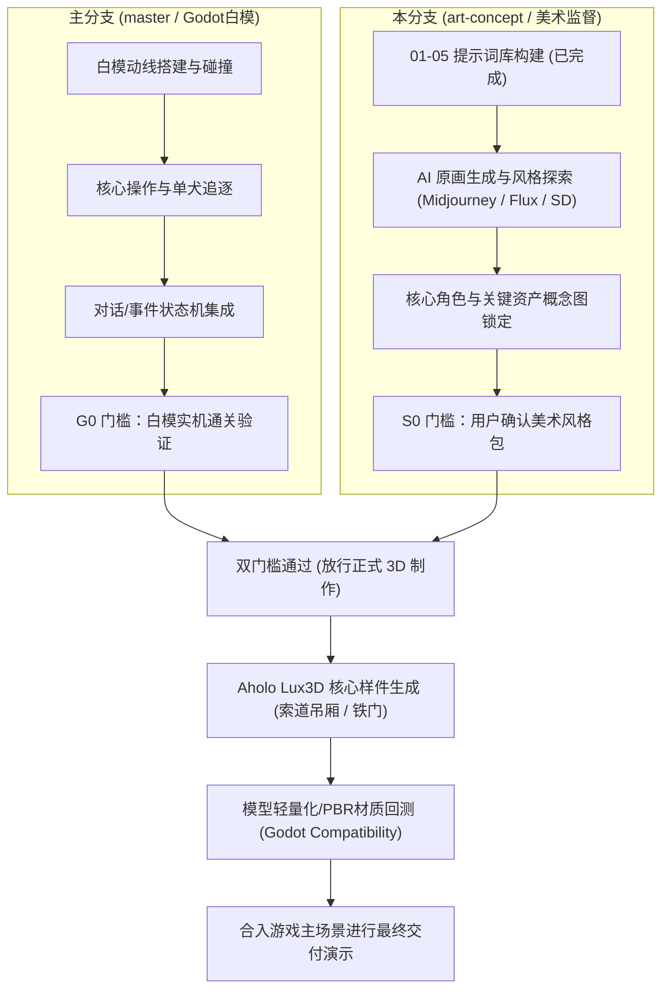

# 《一口猪在金牌农场》美术原画与资产生产工作区 (Art Concept Worktree)

> **2026-11-02 实际集成进度**：`master` 已接入 36 件运行模型、七个角色动画与完整双结局流程。`0.6.0-enriched-farm` 新增 18 件地编模型，完成 1,684 个实例和连续山坡。见 [地编交付与提示词](07_ENVIRONMENT_DRESSING.md) 和 [资产清单](ASSET_MANIFEST.md)。以下分支流程保留为初始生产约定。

> **分支说明**：`art-concept` (独立 Git Worktree: `piggame-art`)  
> **核心职责**：负责游戏视觉风格定义、原画/概念图生成提示词工程、2D立绘/UI设计、以及面向 **Aholo Lux3D** 的核心 3D 资产提示词与生成监督。  
> **协同关系**：本分支与代码主分支（`master`，负责 Godot 白模与玩法逻辑）完全解耦并行。美术产出在达到 **S0 风格门槛** 并在主分支完成 **G0 白模实机门槛** 后，直接向游戏管线交付正式资产。

---

## 一、目录结构规范

```text
piggame-art/
├── docs/
│   ├── art/                                # 美术资产设计与提示词体系中心
│   │   ├── README.md                       # 本说明文件
│   │   ├── 01_ART_STYLE_GUIDE_AND_PROMPT_SYSTEM.md # 美术总风格与双管线提示词公式
│   │   ├── 02_CHARACTER_PROMPTS.md         # 全角色设定与全向提示词库 (中英双语)
│   │   ├── 03_CORE_PROP_AND_3D_ASSET_PROMPTS.md # 核心道具与 Lux3D 3D资产提示词库
│   │   ├── 04_ENVIRONMENT_AND_SCENE_PROMPTS.md # 关卡场景概念图提示词库
│   │   ├── 05_UI_AVATAR_AND_ILLUSTRATION_PROMPTS.md # 对话头像/成就徽章/结局插画提示词
│   │   └── 06_AHOLO_LUX3D_PIPELINE_AND_QUICKSTART.md # Aholo Lux3D 3D生成实操指南与验收标准
│   ├── GDD_GAME_DESIGN.md                  # 游戏总体设计文档
│   ├── PIG_STORY_LINE_FULL.md              # 故事全本与人物小传
│   └── PRODUCTION_MASTER_PLAN.md           # 生产推进主计划
└── assets/
    └── art_references/                     # 概念图、提示词试验产物与风格参考目录
        ├── characters/                     # 角色三视图、表情、立绘
        ├── props/                          # 核心道具 2D 概念图 (用于 Image-to-3D)
        ├── environments/                   # 场景氛围图
        ├── ui/                             # 头像、成就图标、结局插图
        └── aholo_models/                   # Lux3D 导出原件与优化后 glTF 资产
```

---

## 二、双门槛协同工作流程 (Parallel Workflow)



---

## 三、当前制作清单（2026-11-02）

14 件核心资产、4 类初期环境构件和 18 件 ENV_09 地编资产已完成制作和接入，七个角色已有骨骼与循环动画。下表列出初期 18 件；新增模型、任务号、面数和提示词见 [ENV_09 清单](07_ENVIRONMENT_DRESSING.md)。详细来源、人工修复和验证见 [资产合成交付清单](ASSET_MANIFEST.md)。

| ID | 名称 | Lux3D 任务 | 运行时三角面 | 接入与行为 |
| --- | --- | ---: | ---: | --- |
| CHAR_01 | 猪包子 | 4568990 | 7157 | 玩家；047 耳标、红印、口衔插销；四足行走/奔跑 |
| CHAR_02 | 老岩羊 | 4566594 | 6336 | 序幕交互；卷角、黑点眼；待机 |
| CHAR_03 | 老黄牛 | 4566597 | 6336 | 黑土垄交互；完成任务后走向水槽 |
| CHAR_04 | 小绵羊 | 4568995 | 1536 | 剪毛棚；完成任务摘牌，走向阳光 |
| CHAR_05 | 追风 | 4566600 | 6671 | 赛道交互；红色奖章；任务后移动 |
| CHAR_06 | 护院犬 | 4566603 | 6336 | 动态追逐；行走/奔跑动画跟随实际速度 |
| CHAR_07 | 农场主 | 4569000 | 6336 | 铁门对决；电棍跟随手臂骨骼 |
| PROP_01 | 索道吊厢 | 4566276 | 4156 | 木厢、悬挂杆、双滑轮；跟随现有索道运动 |
| PROP_02 | 铁门 | 4569003 | 3998 | 4.8 米宽；独立 GateLeft / GateRight 铰链 |
| PROP_03 | 红铜插销 | 4569008 | 3999 | 随猪头骨骼；按剧情显示 |
| PROP_04 | 顽石与犁 | 4569112 | 4000 | 黑土垄场景；独立视觉与原碰撞契约 |
| PROP_05 | 三等残次吊牌 | 4569117 | 4000 | 羊头挂点；可读文字；完成隐藏、重置恢复 |
| PROP_06 | 纪录看板 | 4569130 | 4000 | 赛道交互根；文字用 Label3D 保证可读 |
| PROP_07 | 电棍 | 4566606 | 4240 | 黑黄安全色环；破门后隐藏 |
| ENV_01_TROUGH | 石水槽 | 4569267 | 220 | 猪圈和赛道复用；槽壁与水面 |
| ENV_06_HAY | 圆草捆 | 4569274 | 4000 | 农场多处复用；保留障碍碰撞 |
| ENV_06_CRATE | 木箱 | 4569279 | 4000 | 农场多处复用；按原尺寸缩放 |
| ENV_06_TRACTOR | 拖拉机 | 4569284 | 4000 | 追逐院左侧，避开主通路 |

环境编号以实际 2D 文件为准：ENV_02 为蓝线泥窝结局，ENV_08 为金色麦浪红线结局；其余场景通过构件和程序几何组合。
