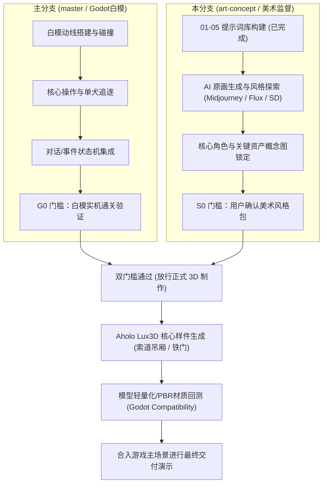

# 《一口猪在金牌农场》美术原画与资产生产工作区 (Art Concept Worktree)

> **分支说明**：`art-concept` (独立 Git Worktree: `piggame-art`)  
> **核心职责**：负责游戏视觉风格定义、原画/概念图生成提示词工程、2D立绘/UI设计、以及面向 **Aholo Lux3D** 的核心 3D 资产提示词与生成监督。  
> **协同关系**：本分支与代码主分支（`master`，负责 Godot 白模与玩法逻辑）完全解耦并行。美术产出在达到 **S0 风格门槛** 并在主分支完成 **G0 白模实机门槛** 后，直接向游戏管线交付正式资产。

---

## 一、目录结构规范

```text
piggame-art/
├── docs/
│   ├── art/                                # 美术资产设计与提示词体系中心
│   │   ├── README.md                       # 本说明文件
│   │   ├── 01_ART_STYLE_GUIDE_AND_PROMPT_SYSTEM.md # 美术总风格与双管线提示词公式
│   │   ├── 02_CHARACTER_PROMPTS.md         # 全角色设定与全向提示词库 (中英双语)
│   │   ├── 03_CORE_PROP_AND_3D_ASSET_PROMPTS.md # 核心道具与 Lux3D 3D资产提示词库
│   │   ├── 04_ENVIRONMENT_AND_SCENE_PROMPTS.md # 关卡场景概念图提示词库
│   │   ├── 05_UI_AVATAR_AND_ILLUSTRATION_PROMPTS.md # 对话头像/成就徽章/结局插画提示词
│   │   └── 06_AHOLO_LUX3D_PIPELINE_AND_QUICKSTART.md # Aholo Lux3D 3D生成实操指南与验收标准
│   ├── GDD_GAME_DESIGN.md                  # 游戏总体设计文档
│   ├── PIG_STORY_LINE_FULL.md              # 故事全本与人物小传
│   └── PRODUCTION_MASTER_PLAN.md           # 生产推进主计划
└── assets/
    └── art_references/                     # 概念图、提示词试验产物与风格参考目录
        ├── characters/                     # 角色三视图、表情、立绘
        ├── props/                          # 核心道具 2D 概念图 (用于 Image-to-3D)
        ├── environments/                   # 场景氛围图
        ├── ui/                             # 头像、成就图标、结局插图
        └── aholo_models/                   # Lux3D 导出原件与优化后 glTF 资产
```

---

## 二、双门槛协同工作流程 (Parallel Workflow)



---

## 三、首批核心任务清单 (Task Tracker)

| 资产编号 | 资产名称 | 优先级 | 用途 | 提示词文档索引 | 状态 |
| :--- | :--- | :---: | :--- | :--- | :---: |
| **PROP_01** | **后山悬崖索道站与木吊厢** | **P0 (比赛核心)** | 突围逃生终点，Lux3D重点展示 | `03_CORE_PROP` 第 1 节 | 提示词就绪 |
| **PROP_02** | **后山重型大铁闸门与碎锁** | **P0 (比赛核心)** | 终局对决边界，阻挡与破门演出 | `03_CORE_PROP` 第 2 节 | 提示词就绪 |
| **PROP_03** | **生锈红铜插销 (红丸道具)** | **P0 (叙事核心)** | 贯穿全剧的红色抉择信物/索道钥匙 | `03_CORE_PROP` 第 3 节 | 提示词就绪 |
| **CHAR_01**| **特立独行的猪“包子” (#047)**| **P0 (主角)** | 玩家操控角色，黄色耳标+鲜红出栏印 | `02_CHARACTER` 第 1 节 | 提示词就绪 |
| **CHAR_02**| **老岩羊 (The Bighorn)** | P1 (先导NPC) | 序幕悬崖残墙上的破局指引者 | `02_CHARACTER` 第 2 节 | 提示词就绪 |
| **CHAR_03**| **老黄牛 (The Relentless Ox)** | P1 (关键NPC) | 黑土垄拉犁苦修者，顽石/水渠交互 | `02_CHARACTER` 第 3 节 | 提示词就绪 |
| **CHAR_04**| **小绵羊 (The Soft Sheep)** | P1 (关键NPC) | 剪毛棚“三等残次”软毛觉醒者 | `02_CHARACTER` 第 4 节 | 提示词就绪 |
| **CHAR_05**| **中年烈马“追风”** | P1 (关键NPC) | 执念41秒金牌，被35秒新牌触动的奔跑者 | `02_CHARACTER` 第 5 节 | 提示词就绪 |
| **CHAR_06**| **护院犬群** | P1 (追逐敌怪) | 空地追逐战中包夹拦截的犬队 | `02_CHARACTER` 第 6 节 | 提示词就绪 |
| **CHAR_07**| **农场主 (手持电击棍)** | P1 (对决Boss) | 终极大铁门前三回合现实对决人类 | `02_CHARACTER` 第 7 节 | 提示词就绪 |
| **ENV_01** | **山顶悬崖猪圈 (序幕)** | P1 (场景原画) | 冷雾绝壁与抢食猪群氛围 | `04_ENVIRONMENT` 第 1 节 | 提示词就绪 |
| **ENV_02** | **金色麦浪群山 (结局旷野)** | P1 (场景原画) | 索道飞驰下山的自由壮美景观 | `04_ENVIRONMENT` 第 7 节 | 提示词就绪 |

